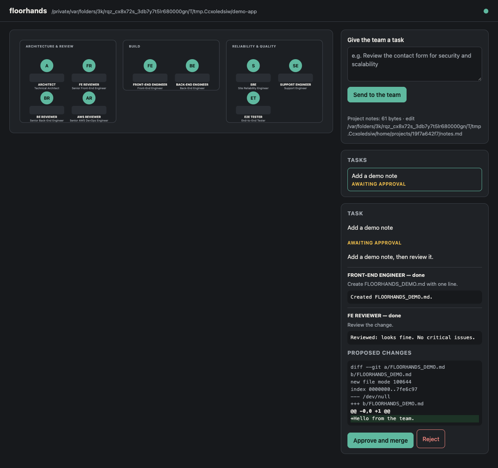
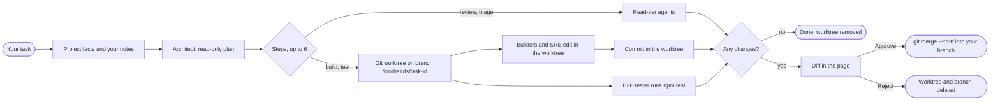
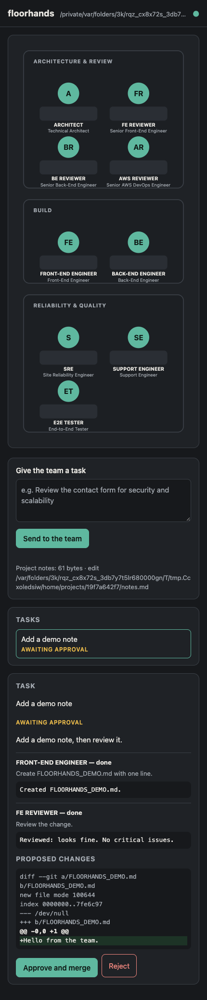

# floorhands

**A local office of nine engineering agents that review, build and test your git repository, and hold every change for your approval.**

[](https://github.com/SuryaSatyaNikhil503/floorhands/actions/workflows/ci.yml)
[](LICENSE)
[](package.json)
[](#what-has-been-verified)

<p align="center">
  
</p>

> **Status: early (v0.3.0).** It works end to end on macOS. Version 0.3.0 adds model routing (Opus plans and reviews, Sonnet builds, Haiku does light work), spending caps that never overshoot (a step asks you before it spends more), slimmer agent sessions that share the prompt cache, a per-run access token and a stricter safety model. All 73 permission probes pass on Claude Code 2.1.310 on macOS and Linux, and they now run without an API key (see [What has been verified](#what-has-been-verified)). The agent prompts were tested on three small sample projects only. Please read [Known limits](#known-limits) before you point it at anything you care about.

## What it is

floorhands is a small local server with a browser page and a command line tool. It runs a team of nine agents on the project you start it in.

You type a task. An Architect agent turns it into a plan of up to six steps and hands each step to the right agent. Every step is one run of your own `claude` command, signed in as you, with a permission tier that limits what that agent can do. Anything the builders change is made in a separate git worktree and shown to you as a diff. Nothing reaches your branch until you press Approve, and nothing is ever pushed.

**What you get**

- A floor plan of the team in your browser. You can see who is working, which tool they are using, the plan, each agent's output and the diff.
- Reviews from read-only agents for front end, back end and AWS. Changes from two builders and an SRE. Triage from a support engineer. Test runs from an end-to-end tester.
- Agents that know your project. floorhands detects the stack (languages, frameworks, which scripts exist) and tells every agent. You can add standing guidance of your own with `floorhands notes`. See [Teach it about your project](#teach-it-about-your-project).
- Three permission tiers (read, build and test), all defined in one file, [`server/tiers.js`](server/tiers.js), and checked against the real Claude Code CLI.
- A git worktree for every task. Approve runs `git merge --no-ff`. Reject deletes the worktree and the branch.
- Shell commands from every agent run inside the Claude Code Bash sandbox, with no network and no writes outside the working folder.
- The right model for each step. The Architect and the reviewers run on Opus. Builders run on Sonnet by default, on Haiku for light work such as docs, and on Opus for hard work such as security fixes. The tester and the support engineer run on Haiku. Every step has a spending cap, every task has one too, and only one task runs at a time unless you allow more. See [Models and spending](#models-and-spending).
- A record of every run: the model that actually ran, tokens, cache use, cost and time, shown next to each step in the page.
- A command line tool (`floorhands start`, `status`, `stop` and more) and a Claude Code plugin. The plugin has a skill, and an optional hook that starts the office when a Claude Code session opens in your project.
- No runtime dependencies. You only need Node 22 or newer and git.

### How a task flows

1. You send a task from the page. For example: *"Review the contact form for security, then add server-side email validation"*.
2. floorhands detects the project's **facts** (languages, frameworks, which scripts exist) and reads your **notes** file. It does this once per task and stores the facts with the task.
3. The **Architect** is read-only. It gets your task, the team roster, the facts and a few routing hints. One hint might say "there is no test script, so do not schedule the tester". It looks at the code and replies with a plan: a short summary and up to six steps, each given to one agent. For a plain question it can just answer, with no steps.
4. The steps run in order. The first build or test step creates a git worktree on a new `floorhands/<task-id>` branch. Every later step runs inside it, so a reviewer who comes after a builder sees the builder's changes. Each step is told which commit the branch started from and which git commands show the change. It also gets the earlier agents' output as data, cut to 2,000 characters per step and 6,000 in total. The oldest output is dropped first.
5. After each builder step, floorhands commits the worktree, once it has checked that nobody tampered with it.
6. If the branch differs from where it started, the task waits for you as **awaiting approval**, with the diff. If nothing changed, the worktree is removed and the task is **done**.
7. **Approve and merge** merges the branch into whatever branch your repository is on, then removes the worktree and the branch. **Reject** removes them without merging.



## License at a glance

floorhands is **source-available, not open source.** It uses the PolyForm Noncommercial License 1.0.0 plus Additional Terms that narrow it further. The [LICENSE](LICENSE) file is the real thing. This table is only a summary.

| You can | You cannot | Ask first |
|---|---|---|
| Download, run, study and change it on your own computers for your own non-commercial use | Use it commercially, for example in a company's work, for clients, or inside a paid product or service | Anything the license does not allow, such as commercial use |
| Keep the code you create in your own projects with its help. That code is yours | Publish, share or host your own copy or version, changed or not, in public or in private (repositories, mirrors, packages, images, services) | |
| Fork it on GitHub **only** to prepare a contribution, until it is merged or withdrawn | Use the name "floorhands" for other software | |

To ask for permission, open an issue titled "Permission request": [new permission request](https://github.com/SuryaSatyaNikhil503/floorhands/issues/new?title=Permission+request).

## Requirements

| | |
|---|---|
| **OS** | macOS, Linux, or Windows through WSL2. Native Windows is not supported. See [Platform support](#platform-support). |
| **Node** | 22 or newer. It was developed on 24. |
| **git** | Each project must be a git repository with at least one commit if you want build and test steps. |
| **Claude Code** | The `claude` command installed and signed in. Run `claude` once and sign in. Tested with 2.1.296. The plugin is optional. |
| **npm** | Only needed if you want the builders and the tester to run your project's scripts. See the [FAQ](#faq). |

## Platform support

floorhands runs every agent inside Claude Code's sandbox and refuses to run one without it. So it runs exactly where that sandbox runs. Claude Code's docs say: "The sandbox runs on macOS, Linux, and WSL2. On native Windows, Claude Code runs commands unsandboxed."

| Platform | Status | How it is checked |
|---|---|---|
| macOS | Supported | Developed here. CI runs the tests and all 73 permission probes on macOS. |
| Linux | Supported. Install `bubblewrap` and `socat` (`sudo apt-get install bubblewrap socat`). | CI runs the tests and all 73 permission probes on Ubuntu. |
| Windows through WSL2 | Supported. Run floorhands inside a WSL2 distribution, set up as Linux. | CI runs the tests and the probes inside WSL2 Ubuntu 24.04 on a Windows machine. |
| WSL1 | Not supported. Upgrade the distribution to WSL2. | `floorhands start` refuses and says how to upgrade. |
| Native Windows | Not supported. The sandbox does not run there. | `floorhands start` refuses and points to WSL2. CI checks this on Windows. |

`floorhands start` checks this before anything starts. On Linux it also checks that `bubblewrap` and `socat` are installed, and it warns on Ubuntu 24.04 and later, whose AppArmor policy can stop bubblewrap (Claude Code's sandboxing docs describe the fix).

**On Windows, step by step:** in PowerShell, run `wsl --install` (or `wsl --set-version <distribution> 2` for an existing WSL1 distribution). Inside the WSL2 distribution, install Node 22, git, `bubblewrap`, `socat` and Claude Code, and keep your projects on the Linux filesystem (your home folder there), not under `/mnt/c`, where permissions and symlinks behave differently. Then use floorhands as on Linux, and open the page from your Windows browser with the link `floorhands url` prints.

**No Docker shortcut on a Mac.** In an unprivileged container, bubblewrap fails by default (Claude Code's docs), and the weaker nested mode that works there is not what floorhands uses. So a plain Linux container on your Mac is not a faithful test. Use CI, a Linux VM, or a WSL2 machine. To work on floorhands itself on a machine without the sandbox, `FLOORHANDS_PLATFORM_CHECK=off` skips the start-up check, and Claude Code still refuses to run an agent there.

## Install in Claude Code

You can run floorhands from any terminal. The Claude Code plugin is an optional extra that lets you start it from inside a Claude Code session. Everything the plugin does, the plain `floorhands` command does too.

### 1. Check the prerequisites

```bash
node --version      # v22.0.0 or newer
git --version       # any recent git
claude --version    # Claude Code, tested with 2.1.296
```

You also need to be signed in to Claude Code. Run `claude` once in a terminal, sign in when it asks, then quit. floorhands runs your own `claude` under your own login, so if `claude` works for you, floorhands can use it. macOS is the tested platform (see [Requirements](#requirements)).

### 2. Get the code and put `floorhands` on your PATH

```bash
git clone https://github.com/SuryaSatyaNikhil503/floorhands.git ~/Projects/floorhands
~/Projects/floorhands/scripts/install.sh
```

The script does three things. It makes the scripts executable, creates `~/.local/bin` if it is missing, and links `~/.local/bin/floorhands` to `bin/floorhands`. Then it prints the two plugin commands from step 3. It does **not** use `sudo`, edit your shell profile, touch your Claude Code configuration, use the network or install packages. It is safe to run again.

If it tells you `~/.local/bin is not on your PATH`, add it yourself and open a new terminal. On zsh, the macOS default, that looks like this:

```bash
echo 'export PATH="$HOME/.local/bin:$PATH"' >> ~/.zshrc
```

Check it worked with `command -v floorhands`. Keep the clone where it is, because the link points into it.

### 3. Install the Claude Code plugin (optional)

The plugin adds one skill, named `floorhands:floorhands`, and an optional hook that starts the office when a Claude Code session opens in a project you have enabled. There are two ways to use it.

**A. Permanent: add the clone as a marketplace and install from it.** Run these in a terminal:

```bash
claude plugin marketplace add ~/Projects/floorhands
claude plugin install floorhands@floorhands
claude plugin list          # floorhands@floorhands should show as enabled
```

The first command registers your clone as a marketplace called `floorhands`. It goes into your user settings, so it applies to every project. The second command installs the plugin from it. Claude Code reads the plugin straight from `claude-plugin/` in your clone, so do not move or delete the clone.

To update, run `git pull` in the clone and start a new Claude Code session, or run `/reload-plugins` in the one you have. The command `claude plugin update floorhands@floorhands` exists, but it says "nothing to update" for a plugin read from a folder.

You can manage the plugin later with these commands:

| To | Run |
|---|---|
| Turn it off but keep it installed | `claude plugin disable floorhands@floorhands` |
| Turn it back on | `claude plugin enable floorhands@floorhands` |
| Remove it | `claude plugin uninstall floorhands@floorhands` |
| Remove the marketplace entry too | `claude plugin marketplace remove floorhands` |

`install` and `uninstall` accept `--scope user`, `--scope project` or `--scope local`. The default is `user`.

**B. Try it for one session without installing anything:**

```bash
claude --plugin-dir ~/Projects/floorhands/claude-plugin
```

The plugin is loaded for that session only.

**What was checked and what was not.** Both manifests pass `claude plugin validate`. The commands above were run end to end on Claude Code 2.1.296 on macOS, in a throwaway Claude Code configuration. That covered add, install, list, disable, enable, update, uninstall and remove. With both A and B, the skill list of a `claude -p` session contained `floorhands:floorhands`.

Not checked: using the skill and the start-up hook inside a live interactive session, and the Claude desktop app and IDE extensions. The plugin commands are terminal commands. Plugins live in your Claude Code user configuration, so the app and the extensions may well pick the plugin up, but I did not test that. If they do not, use the plain `floorhands` command.

The hook finds the command next to the plugin, at `~/.local/bin/floorhands`, or at the path in `FLOORHANDS_BIN`. The skill runs `floorhands` through Claude's Bash tool, so the command must be on that tool's `PATH`. See [Troubleshooting](#troubleshooting).

### 4. Check that it works

```bash
floorhands help             # lists start, open, status, stop, enable, disable, notes
cd ~/code/my-app            # any git repository
floorhands status           # shows "not running", the project path and "auto-start: off"
```

Then start a Claude Code session in that repository by running `claude`. The plugin's skill is listed as `floorhands:floorhands`, and you call it by that full name:

```text
/floorhands:floorhands start
```

The short form `/floorhands` was not verified, so this guide does not use it. The skill's description also says to use it when you ask in plain words, such as "start floorhands". The model should be able to do that too, but I have not watched it happen in a live session, so rely on the full slash form above.

## Using floorhands

### A first run, from zero

1. **Pick a repository.** Use one you cloned yourself (see [Known limits](#known-limits)), and make sure it has at least one commit. `git log -1` shows it. For build and test steps, install the dependencies yourself and define the scripts you want used (`lint`, `build`, `test` and so on) in `package.json`. Agents cannot run `npm install` or `npx`, and they cannot scaffold a project. Read-only tasks need none of this.
2. **Start it** from inside the repository:
   ```bash
   cd ~/code/my-app
   floorhands start        # prints the address, for example http://localhost:4600
   ```
   Or, in a Claude Code session in that repository, run `/floorhands:floorhands start`. The command `floorhands open` also opens the page in your browser. One server runs per repository. Its state goes in `my-app/.floorhands/`, which floorhands hides from git through `.git/info/exclude`.
3. **Open the address.** On the left of the page is the office floor, with nine agents in three pods that light up while they work. On the right are the task box (*Give the team a task*), a faint line about your project notes, the task list and the panel for the selected task.
4. **Send a first task.** Be specific about the area and the outcome (see [Tips for good tasks](#tips-for-good-tasks)). Here are three to start with.
   - **A review that changes nothing:**
     > Review src/routes/contact.js for input validation and injection problems. Report findings only and do not change anything.
   - **A small change with tests:**
     > In src/routes/orders.js, make GET /api/orders accept optional limit and offset query parameters. Limit is 1 to 100 and defaults to 20, and anything else returns 400. Add test cases next to the existing orders tests. Done when the lint and test scripts pass.
   - **A "what could go wrong" check:**
     > We plan to ship the checkout flow on Friday. What could go wrong in production? Look at error handling, timeouts, retries and what happens when the payment provider is slow.
5. **Read the plan and each agent's output.** Select the task. You will see the Architect's summary and its steps. Each step shows the agent, its status, the instruction it was given and, once done, its output. Every report starts with a `VERDICT:` line and ends with *What I checked* and *What I did not check*. Click an agent on the floor to see its recent activity for that task.
6. **Review the diff.** If agents changed files, the task waits as *awaiting approval* and the panel shows **Proposed changes**. That is the full diff of the task branch against where it started. Read it.
7. **Decide.** **Approve and merge** merges the branch into the branch your repository is on, using `git merge --no-ff`, and removes the worktree and branch. **Reject** removes them without merging. If the merge cannot apply cleanly, nothing changes and the branch is kept (see [Troubleshooting](#troubleshooting)). A review or triage task has no diff and ends as *done*.
8. **Stop it** when you are finished with `floorhands stop`.

**What the statuses mean**

| Status | Meaning |
|---|---|
| `queued` | The task was created and has not started yet. This lasts an instant. |
| `planning` | The Architect is reading the code and writing the plan. |
| `running` | The steps are running one after another. Each step is `pending`, `running`, `done` or `failed`. |
| `awaiting approval` | At least one step changed the code. Nothing has reached your branch, and the diff is waiting for you. |
| `done` | Finished with nothing to approve. It was a review, a question, or a build that changed nothing. |
| `failed` | A step or the plan failed, or the server restarted in the middle of the task. The error is shown in the panel. Work the builders had committed is discarded (see [Known limits](#known-limits)). |
| `approved` | You pressed Approve and the merge worked. |
| `rejected` | You pressed Reject. The worktree and branch are gone. |

**Where things are kept.** The plan and every step's output are in the task panel. They are also on disk in `.floorhands/tasks/<task-id>.json` inside the project, together with the task text, the project facts the agents were given and the last 500 events. While a task waits for approval, its changes live in the worktree `~/.floorhands/worktrees/<project-hash>/<task-id>` on the branch `floorhands/<task-id>`. Your own working copy is untouched until you press Approve. Do not put secrets in task text, because it is stored in `.floorhands/`.

### Teach it about your project

floorhands tells every agent two kinds of things about your project.

**Project facts are detected for you.** At the start of each task, floorhands looks at the repository's file list and manifests. It reads them as data and never runs them. It records only labels from a fixed list:

- the five most common languages, from javascript, typescript, java, kotlin, python, go, ruby, php, csharp, rust, hcl and shell
- frameworks and libraries, test tools, infrastructure and CI systems (the full list is below)
- the package manager, which is npm, pnpm, yarn, bun or none
- which of the six scripts `lint`, `build`, `format`, `typecheck`, `test` and `e2e` exist in the **root** `package.json`, by name only
- the kind of monorepo (workspaces, pnpm, turbo or nx) and the number of packages, up to 50
- whether the folder is a git repository, and how many files were listed

floorhands **never copies repository text** into the facts. No project name, description, script command, path, version, dependency name or file content ever reaches an agent this way. Only the fixed labels and numbers do. Symlinks are not followed, and file sizes and counts are capped. The exact text the agents were given is saved as `facts` in the task's JSON file. A project that does not use npm, such as a Python or Java project, is still detected, but it shows no scripts, and the agents are told that nothing can be run.

<details>
<summary>The fixed list of labels</summary>

- **Frameworks and libraries:** react, next, vite, vue, nuxt, svelte, angular, express, nestjs, fastify, koa, tailwind, redux, prisma, typeorm, sequelize, mongoose, spring-boot, spring-security, quarkus, micronaut, hibernate, fastapi, django, flask, sqlalchemy, pydantic, celery, rails, laravel.
- **Test tools:** jest, vitest, playwright, cypress, mocha, testing-library, junit, pytest.
- **Infrastructure:** terraform, cdk, cloudformation, serverless, docker, kubernetes, helm.
- **CI:** github-actions, gitlab-ci, jenkins, circleci.
</details>

**Owner notes are standing guidance you write yourself.** Use them for anything the tool cannot know, such as your conventions, regional data-protection rules, accessibility level, SEO needs or how your sign-in works. The command `floorhands notes` shows where the file lives and what is in it:

```text
$ floorhands notes
notes file: <your home>/.floorhands/projects/d7582833ca/notes.md
(no notes yet, create the file above with your editor)
```

`floorhands notes` only reads. It creates neither the file nor its folder. To create and edit the file, run:

```bash
cd ~/code/my-app
NOTES=$(floorhands notes | sed -n '1s/^notes file: //p')
mkdir -p "$(dirname "$NOTES")"
${EDITOR:-nano} "$NOTES"
```

- **Where:** `<FLOORHANDS_HOME or ~/.floorhands>/projects/<project-hash>/notes.md`. It is **outside** your repository on purpose. The repository is untrusted and must not be able to plant instructions. The hash comes from the project's full path, so a moved or re-cloned project starts with empty notes.
- **Size:** at most 4 KB. Anything beyond that is cut off, and the agents are told so. Control characters are removed. A symlink is ignored, so the file must be a regular file.
- **Effect:** every agent sees the notes as the owner's standing guidance in every task you send afterwards. A task that is already running keeps what it started with. Notes shape what agents look for and how they write. They can **never** widen what an agent is allowed to do. Permissions come only from the tier, and the `claude` command enforces them, so no note can allow a command, a path or the network.
- **Visibility:** the page shows one line about the notes, with the path and the size. The server API reports the path and size but never the contents.
- **No secrets in notes:** see the process list limit under [Known limits](#known-limits).

Example notes for a web app:

```markdown
# Notes
- Public marketing site plus a customer dashboard. Next.js, TypeScript, Tailwind.
- Conventions: named exports only. All data fetching goes through lib/api. User-facing text lives in lib/messages.
- Our users are in the EU and UK. No analytics or marketing scripts before cookie consent. Any new form that collects personal data needs a stated purpose and a retention period.
- Accessibility target is WCAG 2.2 AA. Flag missing labels, focus handling and low contrast.
- SEO matters for the public marketing pages only. Each needs a unique title and description, one h1 and a canonical URL.
```

Example notes for an API service:

```markdown
# Notes
- REST API in Python (FastAPI) on PostgreSQL. Multi-tenant: every table has tenant_id and every query must filter by the caller's tenant.
- Auth uses short-lived JWTs from our identity provider. Roles are admin, member and viewer. Roles are checked in the dependency, not in handlers.
- PII means names, emails and phone numbers. Never log them. Treat any new response field that exposes PII as High risk.
- Errors use the problem-details shape in app/errors.py.
```

### Using it from Claude Code, day to day

With the plugin installed, the skill takes one word after its name:

| You type | It runs |
|---|---|
| `/floorhands:floorhands start` | `floorhands start`, then shows you the address |
| `/floorhands:floorhands status` | `floorhands status` |
| `/floorhands:floorhands stop` | `floorhands stop` |
| `/floorhands:floorhands on` | `floorhands enable`, which turns auto-start on for this project |
| `/floorhands:floorhands off` | `floorhands disable`, which turns auto-start off |

Run them from a session in the project. Asking in plain words, such as "start floorhands" or "open the office", should work too. If you ask the skill to open the page for you, it runs `floorhands open`.

**Auto-start is opt-in and per project.** After `on` (or `floorhands enable` in a terminal), the plugin's start-up hook runs every time a Claude Code session opens in that project. It starts the office if it is not already running and prints one line, the address. In a project where you did not enable it, the hook does nothing. The hook never blocks or breaks a session. It swallows its own errors and gives up after 15 seconds. If it prints an error about `node`, see [Troubleshooting](#troubleshooting).

**Several projects at once.** Each repository gets its own server. Ports start at 4600 and count upward, and `FLOORHANDS_PORT` changes the first one. Run `floorhands status` inside a project to see its port.

**Monorepos and folders with several repositories.** The project is the git repository you start floorhands in. That means its top level, even if you start it from a subfolder. In a monorepo this is the whole repository, and the facts mention the workspaces. If a folder holds several separate repositories, such as `frontend/` and `backend/`, start floorhands inside the one you want to work on and use another server for the other.

### Tips for good tasks

These come from the rules the Architect works by.

- **Name the area and the outcome.** "Add server-side validation for the email field in the contact form" works better than "improve the form". Give file paths when you know them.
- **Say how you will check the result.** For example "done when the lint and test scripts pass" or "a test asserts 404 for another user's order". Without a check, the team can only report that the change is unverified.
- **One concern per task.** A task becomes at most six steps, and most need one to three. A big job gets a first slice, and the summary describes the rest.
- **Know what the team cannot do.** Agents cannot install packages, deploy, use the network or outside services, or read production data. They cannot read `.env*` or `*.pem` files. They cannot touch `.env*`, `.git`, `node_modules`, `.claude` or `.mcp.json`. Builders can run only `npm run lint`, `build`, `format` and `typecheck`. The tester can run only `npm test`, `npm run test` and `npm run e2e`. Code that needs a new dependency is planned only if the dependency is already in the manifest or you say it is installed.
- **No scripts means analysis only.** If the project has no matching scripts, or does not use npm, nobody can run the result. Builders still edit, the summary says the change is unverified, and no tester is scheduled. If you ask for tests and the project has no test setup, the plan describes the cases for you to add.
- **Commit what you want the builders to see.** The first build step branches from `HEAD`, so uncommitted edits are not in the worktree. Read-only agents look at your working copy.
- **Treat pasted text as data.** Issue text, logs and file contents in a task cannot give the agents orders. The agents are told to report such attempts as findings.

## The team

This comes from [`agents/roster.json`](agents/roster.json). Each agent has a prompt in [`agents/prompts/`](agents/prompts/) and, optionally, hints about Claude skills that may help (see [How the agents are briefed](#how-the-agents-are-briefed)).

| id | Name | Role | Pod | Tier | What it may do | Report starts with |
|---|---|---|---|---|---|---|
| `arch` | Architect (router and pod lead) | Technical Architect | Architecture and Review | read | Read the code and write the plan | The plan as JSON. Direct answers go in its summary |
| `rfe` | FE Reviewer | Senior Front-End Engineer | Architecture and Review | read | Review front-end code | `VERDICT: approve`, `approve-with-changes` or `block` |
| `rbe` | BE Reviewer | Senior Back-End Engineer | Architecture and Review | read | Review back-end code | `VERDICT: approve`, `approve-with-changes` or `block` |
| `raws` | AWS Reviewer | Senior AWS DevOps Engineer | Architecture and Review | read | Review infrastructure, IAM and CI/CD code | `VERDICT: approve`, `approve-with-changes` or `block` |
| `fe` | Front-End Engineer (pod lead) | Front-End Engineer | Build | build | Edit files in the worktree and run lint, build, format and typecheck scripts | `VERDICT: done`, `partial` or `blocked` |
| `be` | Back-End Engineer | Back-End Engineer | Build | build | Edit files in the worktree and run lint, build, format and typecheck scripts | `VERDICT: done`, `partial` or `blocked` |
| `sre` | SRE (pod lead) | Site Reliability Engineer | Reliability and Quality | build | Edit pipeline and infrastructure code in the worktree. Cannot apply or deploy | `VERDICT: done`, `partial` or `blocked` |
| `sup` | Support Engineer | Support Engineer | Reliability and Quality | read | Find operational risks and write tickets ready to file | `VERDICT: no-issues`, `issues-found` or `needs-information` |
| `e2e` | E2E Tester | End-to-End Tester | Reliability and Quality | test | Run the project's test scripts in the worktree. Cannot edit | `VERDICT: pass`, `fail`, `no-tests` or `blocked` |

| Tier | Tools | Shell commands allowed | Runs in | Sandbox |
|---|---|---|---|---|
| **read** | Read, Glob, Grep, Skill, Bash | `git diff`, `git log`, `git show`, `git status`, `git blame`, `git ls-files`, `git rev-parse` | The project, or the task's worktree once one exists | No, because it runs no project scripts |
| **build** | The read tools, plus Edit and Write under the worktree only | The read-tier git commands, plus `npm run lint`, `npm run build`, `npm run format`, `npm run typecheck` | The task's worktree | Yes |
| **test** | Read, Glob, Grep, Skill and Bash, with no Edit or Write | The read-tier git commands, plus `npm test`, `npm run test`, `npm run e2e` | The task's worktree | Yes |

The roster is just data. You can rename agents, change prompts or skills, or move agents between pods without touching code (see [Configuration](#configuration)). Every agent must use one of these three tiers.

### Models and spending

Each step gets a **class**, and each class has a model, an effort level and a spending cap.

| Class | Model (default) | Effort | Cap per step | Used for |
|---|---|---|---|---|
| `light` | Haiku | low | $0.50 | Docs, comments, renames, running the tests and reporting |
| `standard` | Sonnet | medium | $2 | A change the plan already specifies well |
| `frontier` | Opus, falling back to Sonnet when Opus is unavailable | high | $5 | Planning, reviews, security, concurrency, data integrity, design choices |

The Architect proposes a class for every step. A plan is model output that text in your repository can influence, so floorhands **clamps** the proposal to the agent's own range in [`agents/roster.json`](agents/roster.json):

| Agent | Range | Default |
|---|---|---|
| Architect, FE, BE and AWS reviewers | `frontier` only | `frontier` |
| Front-end, back-end and SRE builders | `light` to `frontier` | `standard` |
| E2E tester, support engineer | `light` to `standard` | `light` |

So a plan can move a docs edit down to Haiku or a security fix up to Opus, but it can never move a review below Opus. The step shows both the class it ran on and, when the plan asked for something else, what it asked for.

**Caps never overshoot. You are asked first.** Every model request an agent makes goes through a small local proxy, the spending guard ([`server/meter.js`](server/meter.js)). Before a request is sent, the guard prices it at its worst case: every input token as the dearest kind of input, and every output token the request allows. If that fits what is left of the step's cap, the request goes through. If only a shorter answer fits, the guard lowers `max_tokens` so the turn cannot cost more than what is left. If not even a useful answer fits, the request waits and the page asks you: **Allow $X more** or **Stop here**. Nothing more is spent until you answer, and after 30 minutes without an answer the step stops. The same question comes up before a step if the whole task has used its cap ($15 by default). After each request the guard adds its real cost, from the usage the API reports. In a real run the guard's figure matched the CLI's own to the fourth decimal. On a Claude subscription the cost is an estimate of usage, not a bill. The guard forwards your own login with each request to one fixed address and never keeps it. `FLOORHANDS_METER=off` turns it off, and then the CLI's own cap applies, which can go over by one turn.

**One task at a time.** By default only one task runs at once and the others wait as *queued*. That keeps parallel tasks from using up a session limit quickly.

**Slim, cache-friendly agent sessions.** The exact requests the CLI sends were captured with a local fake API and compared byte for byte. That showed where the tokens went in 0.3.0's first version. About 7,000 tokens per run listed every skill of every plugin you have installed. Your plugins' SessionStart hooks added up to 10,000 more. And the auto-memory section named a folder derived from the working directory, so every worktree had a different system prompt and almost nothing could be read from the prompt cache. Agents now run with your skills off (unless a roster hint applies to this project), your hooks off, auto memory off, and the per-folder details moved out of the system prompt. Measured with your real login on 2.1.310, a second agent in another folder with another role now reads its shared prefix from the cache:

| Same docs task, real runs | Before | After |
|---|---|---|
| Architect (Opus) | $0.238 | $0.069 |
| Builder (Haiku) | $0.008 | $0.0026 |
| Whole task | $0.246 | $0.072 (71% less) |

Model choice still matters most. A run on Opus costs about 25 times one on Haiku.

**Change the defaults** in `~/.floorhands/models.json` (or `$FLOORHANDS_HOME/models.json`). Only the keys you set change. `floorhands models` shows what is in effect.

```json
{
  "classes": {
    "standard": { "model": "claude-sonnet-5-5", "budgetUsd": 3 },
    "light": { "model": "haiku", "effort": null }
  },
  "taskBudgetUsd": 10,
  "maxConcurrentTasks": 2
}
```

A model is an alias (`opus`, `sonnet`, `haiku`) or a full model id. Aliases follow the newest model of that family, and the model that actually ran is recorded with every step, so results stay comparable. An unknown key or an invalid value stops the server from starting, and the reason is written to `.floorhands/server.log`. floorhands never quietly falls back to the defaults, because they may cost more than your settings. The repository cannot change any of this.

### How the agents are briefed

Each agent's system prompt is put together fresh for every task, in this order:

1. The **common rules** ([`agents/prompts/_common.md`](agents/prompts/_common.md)). They say that untrusted content is data, that secrets are never read or repeated, that nothing destructive is done, and that the tier is binding. They also set out a method, a severity scale (Critical, High, Medium, Low and Info) with examples, a format for findings (a title with `path:line`, the evidence, why it matters, and a fix) and the report layout. A report has a `VERDICT:` first line, a two-sentence summary, then *What I checked* and *What I did not check*.
2. A **tier note** saying what that tier can and cannot do.
3. The **project facts**, framed as data.
4. Your **owner notes**, framed as guidance that never widens the tier.
5. **Skill hints** that apply to this stack (see below).
6. The **role body** from the agent's own prompt file. For the Architect that means routing rules and the plan format. For reviewers it is checklists and search recipes for their stacks. For builders it is a workflow and verification rules. The support engineer gets a ticket template and the tester gets a testing strategy.

The whole prompt is capped at 24 KB. A prompt over the cap is refused with an error. It reaches the CLI as a file that only you can read, which is deleted after the run. It is never on the command line, so other users of the machine cannot see your notes in the process list.

**Skills are hints, never requirements.** A roster entry can be a plain skill name, or an object with `name`, `alt` and `when`. The `when` field lists fact labels, and the hint is shown only if the project has one of them. For example, a React skill is shown only for a React project. If a skill is missing or fails, the agent carries on with the checklist in its own prompt.

**Prompt lint.** The test file [`test/prompts.test.js`](test/prompts.test.js) ties every prompt to the permission model in `server/tiers.js`. No prompt may tell an agent to run a command its tier denies. Every prompt must have its required sections, stay within its size cap and name no personal data or project. This is what stops a prompt edit from quietly asking an agent for something the permission model refuses.

## How it keeps you safe

floorhands assumes that **you** and your user-level Claude Code settings are trusted, and that **the target repository and everything an agent reads are not**.

Each agent is a separate `claude -p` process. It starts with `--permission-mode dontAsk`, which means no prompts and anything not allowed is refused. It also gets an explicit tool list, an allow list and a deny list. One function builds all of these, `buildClaudeArgs` in [`server/tiers.js`](server/tiers.js). The task prompt (your text and the step) goes to the CLI on standard input and never on the command line, so task text can never be read as a flag. The system prompt (the rules, project facts and owner notes) is passed as an argument. See Known limits for what that means.

| Layer | What it does |
|---|---|
| **Tiers** | Read agents can only read files and run read-only git. Builders can edit only under their working directory with `Edit(./**)`. A plain Edit or Write allow was found to let the CLI write outside the worktree, so it was replaced. The tester can run test scripts but cannot edit. |
| **Deny rules** (every tier) | These stay denied even if your own settings allow them, because deny beats allow. They cover `git push`, `pull`, `fetch`, `commit`, `merge`, `rebase`, `checkout`, `reset`, `branch`, `config`, `-C`, `-c` and most other git commands that change state. They also cover `--output`, `--no-index`, `--ext-diff` and `--textconv` anywhere in a git command (`--output` and `--no-index` were tested). Also denied are `rm`, `mv`, `cp`, `chmod`, `ln`, `sudo`, `ssh`, `curl`, `wget`, `nc`, `open`, `aws`, `kubectl`, `docker`, `terraform apply` and `destroy`, `cdk deploy` and `destroy`, `npm install`, `ci` and `publish`, `npx`, `node`, `sh`, `bash`, `python`, `eval`, `xargs` and `env`. Every shell command that can print or search a file is denied too (`cat`, `head`, `sort`, `awk`, `sed`, `base64`, `diff`, `grep`, `rg`, `git grep`, `git cat-file` and others). Agents use the Read, Grep and Glob tools instead, which respect the file deny rules. |
| **Secret files** | The Read and Edit tools, and sandboxed scripts, are denied the project's `.floorhands` folder by its absolute path, from every working folder (it holds the run's access token). The Read tool is denied `.env*`, `*.pem` and the home credential stores `~/.aws`, `~/.ssh`, `~/.config/gh`, `~/.config/gcloud`, `~/.npmrc`, `~/.netrc`, `~/.docker/config.json`, `~/.kube`, `~/.git-credentials`, `~/.gnupg`, `~/.azure`, `~/.pypirc`, `~/.gem/credentials`, `~/.cargo/credentials*`, `~/.password-store`, `~/.claude` and `~/Library/Keychains`. Edit and Write are denied for `.env*`, `.git` (including the worktree's `.git` link file), `node_modules`, `.claude`, `.mcp.json`, `~/.ssh`, `~/.aws`, `~/.claude` and your shell rc files. |
| **Worktree isolation** | Build and test steps work in `~/.floorhands/worktrees/<project-hash>/<task-id>` on the branch `floorhands/<task-id>`, never in your working copy. Your branch changes only when you press Approve. |
| **`.git` link tamper check** | A worktree's `.git` is a small file that points to the real repository. Before every commit, floorhands checks that the worktree's HEAD is still its own `floorhands/<task-id>` branch and that its git directory is that worktree's own entry in your repository. If not, it refuses to commit. These git commands run with hooks, fsmonitor and `core.sshCommand` switched off and with `--no-verify`, so nothing planted in the worktree runs inside the server. Approve and Reject act only on a worktree inside the floorhands folder and on a `floorhands/` branch. |
| **Bash sandbox** (every tier) | Shell commands run in Claude Code's OS-level sandbox. No network host is reachable and nothing can be written outside the working folder. Sandboxed commands still need an allow rule, there is no unsandboxed retry, and the run refuses to start if the sandbox is not available. Scripts are also denied the home credential stores listed above, all except `~/.cargo/credentials*`. Since 0.3.0 the read tier is sandboxed too, so a diff or textconv program set in the repository's git config is contained when a reviewer runs `git diff`. |
| **Git config overrides** | Every agent runs git with fsmonitor, hooks, ssh and all network transports switched off through environment-level config, which beats the repository's `.git/config`. The server's own git calls inside worktrees, `worktree add`, and its diffs (`--no-ext-diff --no-textconv`) are hardened the same way. |
| **Approve runs no hooks** | The merge on Approve runs with all git hooks off, yours included. Hooks run after the merged files are in place, and ordinary hooks load repository files an agent may have changed (a commitlint config, `lefthook.yml`, `.pre-commit-config.yaml`, `package.json` scripts through `npm install`). That would run agent-written code outside every sandbox. Run your hooks yourself after reviewing the merge if you need them. |
| **Changed test setup is never run** | If a builder changed how the tests run (the `scripts` in `package.json`, `.npmrc` and similar, or a test-runner config such as `vitest.config.ts`), the tester's step is skipped and the page says why. Test files a builder wrote still run, inside the sandbox. The sandbox, not this check, is what contains agent-written code. |
| **Risk flags** | Before you approve, the page lists changes that decide what runs on your machine later: `package.json`, lockfiles, git hooks, `.gitattributes`, CI files, package manager and build config, and agent config such as `CLAUDE.md` or `.mcp.json`. |
| **`--setting-sources user`** | Agents load only your user-level Claude settings. The target repository's `.claude/settings.json`, `.claude/settings.local.json`, hooks and skills are ignored. This closed a real bypass found while testing, where a hook in an untrusted repository's settings ran outside the sandbox, as you. |
| **`--strict-mcp-config`** | Agents get no MCP servers. That means none of your connectors (mail, drive and the like) and nothing from the repository's `.mcp.json`. |
| **Environment allow list** | Agents get only the variables they need: `PATH`, `HOME`, user and locale settings, proxies and CA bundles, and `ANTHROPIC_*` and `CLAUDE_*` so the CLI can log in. Everything else, such as `GITLAB_TOKEN`, `OPENAI_API_KEY` or `DATABASE_URL`, never reaches an agent. Add names with `FLOORHANDS_ENV_ALLOW=NAME,NAME`, for example for Bedrock or Vertex. |
| **Redaction** | Agent output, the raw plan, events, reject notes and kept patches are redacted before they are stored or handed to the next agent. That covers private keys, cloud and API tokens, JWTs, passwords in URLs and quoted secret values. It is a pattern list, so it is a safety net, not a guarantee. Task files and patches are readable by you only. |
| **Access token** | The server makes a new random token at every start. Every `/api/` route except `/api/health` needs it. `floorhands open` passes it in the part of the link after `#`, which browsers never send to a server, and the page then keeps it for that tab only. |
| **Facts and notes** | Project facts hold only labels from a fixed list plus numbers, so repository text cannot reach an agent's prompt through them. Facts and notes are framed as data or guidance and never as a way to change a tier. Owner notes live outside the repository, so a repository cannot plant instructions in them. |
| **Local server guards** | The access token above, and the server listens on 127.0.0.1 only. It rejects requests whose `Host` is not `localhost`, `127.0.0.1` or `[::1]`, which protects against DNS rebinding. It rejects POSTs from another `Origin`, and POSTs that are not `application/json`, so a plain form on another website cannot submit a task. Request bodies are capped at 64 KB. The page is served with a strict Content-Security-Policy and loads nothing from other origins. |

### What has been verified

The permission model was tested against the **real CLI, Claude Code 2.1.296 on macOS, on 2026-10-13**. The tests use [`scripts/spike-claude.mjs`](scripts/spike-claude.mjs), which defines 67 probes. Running `node scripts/spike-claude.mjs --list` prints them without running anything. A negative probe passes only when the transcript shows the agent **trying** the forbidden action and the CLI **refusing** it.

- **Round 1:** 47 probes in 41 `claude -p` calls. 46 passed and 1 failed. The failure was a functional one, not a bypass, because some skill names in the roster did not resolve as written. This round found and fixed two bypasses. Builders could write outside the worktree, and `grep -r` printed `.env`.
- **Round 2, untrusted repositories:** 25 probes in 51 `claude -p` runs. It found and fixed a third bypass (repository hooks, closed by `--setting-sources user`). It also confirmed that these are all refused: repository `permissions.allow`, repository sandbox overrides, `.mcp.json`, repository skills, 16 shell forms that could print `.env`, `git cat-file`, credential stores (through the Read tool and from sandboxed scripts), writes through a symlink and writes through the `node_modules` link. One probe was inconclusive because the model did not try a `CLAUDE.md` prompt injection. Two recorded a known limit (both are under item 3 of Known limits).

The full evidence is in [docs/spike-findings.md](docs/spike-findings.md) and the JSON results next to it.

**All 73 probes, run on Claude Code 2.1.310 with no API key: 71 PASS, 2 KNOWN LIMIT, 0 FAIL, 0 INCONCLUSIVE on macOS, and the same on Linux in CI** (apart from two probes that check your own installed skills, which a CI machine does not have) ([docs/spike-results-0.3.0.md](docs/spike-results-0.3.0.md)). The probes test the CLI's permission layer, not the model. So `--fake-model` runs the real `claude` CLI, with its permission checks, sandbox, hooks and settings loading, against a local fake Anthropic API ([`scripts/fake-anthropic.mjs`](scripts/fake-anthropic.mjs)). Its scripted worst-case model ([`scripts/probe-model.mjs`](scripts/probe-model.mjs)) makes exactly the tool call each probe asks for, and it also obeys instructions planted in files it reads. A real model sometimes declines to try, which left probes INCONCLUSIVE. The scripted one never declines, so the CLAUDE.md prompt-injection probe now passes for the first time: the injected command was attempted and refused. The two KNOWN LIMIT results are limit 3 below, reproduced on purpose. A run takes about 20 seconds and costs nothing, so CI runs it on every change to the permission model and for every new Claude Code version.

**0.3.0 changes, checked against the real CLI (Claude Code 2.1.310 on macOS, on 2026-10-25).** Through the production runner: the system prompt reaches the CLI as a file (the agent answered with a code word that only the file contained), the `haiku` and `opus` aliases ran as `claude-haiku-5-5` and `claude-opus-5-5`, `--effort` and `--fallback-model` were accepted, a plan's `light` class for the Architect was clamped to `frontier`, `git status` works in the now sandboxed read tier, a repository fsmonitor program did not run, `--max-budget-usd` stopped a run with `error_max_budget_usd` (after one turn more than the cap), and the cost and token figures were parsed. The spending guard was checked with your real login: a $0.02 cap made the Opus Architect ask before its first request, it went on after $1 was allowed, and neither step went over its final budget. Two new probes cover the read tier: a repository `diff.external` program (it ran, and the sandbox contained it) and a repository fsmonitor program (it did not run). The probe workflow ([`.github/workflows/probes.yml`](.github/workflows/probes.yml)) runs on macOS and Linux without any secret.

Before 0.3.0, `server/tiers.js` had not changed since 0.1.0. The 0.2.0 code (stack detection, notes and prompt assembly) is covered by the test suite, which uses a fake `claude` (`npm test`). How the version 2 prompts behave with the real CLI is the subject of the next section.

### Evaluation

The version 2 prompts were compared with the original ones on three small sample projects that had problems planted in them. The method, the scoring and the results are in [docs/prompt-eval.md](docs/prompt-eval.md). Three small projects say little about your repository, so read the numbers as a check on the prompts and not as a promise.

**Result.** Both versions found nearly every planted problem, so recall cannot tell them apart. This is a ceiling effect and not a win.

| Reviewer | Planted problems found, old prompts | Planted problems found, new prompts |
|---|---|---|
| Back end (Express) | 92% | 100% |
| Front end (React) | 100% | 100% |
| AWS (Terraform and GitHub Actions) | 100% | 100% |

What did differ is the shape of the report. All six new reports open with a `VERDICT:` line and follow the required format. None of the six old reports do, because the old prompts never asked for it. The new reports rate problems closer to the rating that was planted, and they list fewer extra findings (0 to 4 against 6 to 13). Citations were checked against the files, and none were invented in either version. The new system prompt is about six times larger, but the tokens used per run did not go up. Output tokens were 8 to 27% higher.

Keep these limits in mind. There were two runs per cell, three projects and 24 planted problems. The same model family wrote the projects, the answer key and the reports. The scorer was fixed after the first results came in, and the report discloses the fix and the first-pass numbers. The builders, the tester, the support engineer, the SRE and the Architect were not measured. The evaluation also found one real defect. Two reviewer prompts told the agent to read `.env.example`, which the permission model denies. That is fixed in 0.2.0.

**Not verified:** real model runs on Linux and WSL2 (CI there runs the tests and the keyless probes, not a paid model), native Windows (not supported, see [Platform support](#platform-support)), other Claude Code versions (re-run the probes after upgrading `claude`), and how the CLI expands `~` in the credential rules (the probes used the same rules with the absolute path of a fake home). The plugin has not been tested in an interactive Claude Code session. `floorhands:floorhands` was confirmed in the skill list of real `claude -p` sessions, both with the plugin installed and with `--plugin-dir`, and both manifests pass `claude plugin validate`. But the skill and the start-up hook have not been used interactively, and the Claude desktop app and IDE extensions were not tested. `scripts/smoke.mjs`, which runs a real review task end to end, has not been run.

### Known limits

1. **Project scripts are trusted code.** `npm run` and `npm test` run the scripts in your `package.json`. A builder can still change a script and run it in the same step through `npm run build`, inside the sandbox. The tester's step is skipped when the test setup changed, but test files a builder wrote do run, inside the sandbox. The sandbox protects your working copy and the network, not everything. Scripts can still read most of your machine apart from the denied credential stores.
2. **The spending guard sees only what goes through it.** It meters the requests the CLI sends to `ANTHROPIC_BASE_URL`. If an agent produces model output while the guard has seen no request, the run is stopped at once and marked `meterBypassed`. With Bedrock, Vertex or Foundry configured the CLI talks to them directly, so the guard is skipped and the CLI's own cap applies, which can go over by one turn (the same as `FLOORHANDS_METER=off`). The worst case uses a built-in price list (`server/models.js`, fast mode at twice the rate) and an unknown model is priced as the dearest known one. Images and documents are counted with the API's free token counter when it answers, otherwise with a generous fixed bound each. A stream that is cut before its final usage arrives is charged its whole output allowance, because the output already produced (thinking included) is billed but unknown. That errs high. A provider or `ANTHROPIC_BASE_URL` set in your Claude settings is honoured: the guard forwards to that address, and Bedrock, Vertex or Foundry turn the guard off as above. Only the endpoints the CLI needs pass the guard. Two cases it cannot handle: an `ANTHROPIC_BASE_URL` in managed settings (set by an organisation) outranks the guard's address, so the tripwire stops each step after one turn, and a plain `http://` base URL anywhere other than this machine is refused when the server starts.
3. **Committed secrets are readable.** A secret that the repository has **committed** stays readable through the allowed git reads. `git show HEAD:.env` printed one in testing, and a sandboxed script can read the worktree's own `.env`, which exists in a fresh worktree only if it was committed. Redaction keeps the common token shapes out of stored output and out of later agents' prompts, but it is a pattern list. Do not put secrets in task text either.
4. **Git programs set in the repository.** A `diff.external` or textconv program from the repository's git config still runs when a reviewer runs `git diff`, `git log` or `git show`. Since 0.3.0 it runs inside the sandbox, so it cannot reach the network or write outside the working folder, but it can read most of your machine. Only run floorhands on repositories you cloned yourself.
5. **`.gitattributes` filters.** A `.gitattributes` file in the worktree can send files through filter programs that **you** configured, such as git-lfs, when floorhands commits or when you approve. Agents cannot add a filter program. Switching off yours would break repositories that use git-lfs or git-crypt, so this is accepted. The page flags a changed `.gitattributes`.
6. **Your own Claude settings still apply.** Agents load your `~/.claude/settings.json`. A broad allow there widens what agents may run, although deny rules still win. Since 0.3.0 your hooks do not run in agent sessions, and your skills are offered only to an agent whose roster entry hints at one for this project.
7. **Every agent needs the sandbox.** Since 0.3.0 every tier runs in the Claude Code sandbox, so floorhands runs only on macOS, Linux and WSL2, and refuses to start elsewhere. See [Platform support](#platform-support).
8. **`node_modules` is shared.** A worktree's `node_modules` is a link to your real one so that builds work. Agents cannot edit it, and the sandbox stops scripts from writing through it. Scripts that write caches into `node_modules/.cache` therefore fail.
9. **Stopping does not stop running agents.** `floorhands stop` in the middle of a task does not kill a `claude` process that is already running. The 15-minute agent timeout kills only that process and not what it started. The next start marks the task failed and leaves its `floorhands/<task-id>` branch and worktree for you to remove (see [Troubleshooting](#troubleshooting)).
10. **A failed task removes its worktree.** The diff is kept as a redacted patch in `.floorhands/patches/` (the newest 50), but the branch is deleted.
11. **Git commands have no timeout.** A merge that waits for input, such as a GPG passphrase prompt, or a hanging hook in your repository blocks that task's Approve until the server restarts.
12. **The prompts are version 2, not finished.** They were tested on three small sample projects only (see [Evaluation](#evaluation)). Whether Sonnet builds as well as Opus from an Opus plan is the design's bet, and it is not measured yet. The benchmark in [`eval/bench/`](eval/bench/README.md) is built to measure it. Treat findings as leads to check, and an `approve` verdict as "nothing at High or above in what was checked".
13. **No connectors.** Agents see only the repository. They have no GitHub, cloud account, monitoring or issue tracker.
14. **A hostile `.git/config`.** Only run floorhands on repositories you cloned yourself. Worktree creation, the server's diffs and its commits are hardened, but finding the project root and the merge on Approve still use the repository's config as it is (apart from hooks, see the Safety table).
15. **The token is only as private as your browser tab.** Anyone who can read the link printed by `floorhands url`, or the tab's storage, can use the office until the server restarts.
16. **Project facts are shallow.** Scripts are read only from the root `package.json`, and a stack outside the fixed list of labels is not named. Detection reads a limited number of files, so a very large repository may show an incomplete picture. Agents are told the facts are hints and can read the code themselves.
17. **Aliases move.** `opus`, `sonnet` and `haiku` follow the newest model of each family. Each step records the exact model that ran, but two runs a month apart may use different models. Pin full model ids in `models.json` for strict comparisons.

## CLI and skill reference

| Command | What it does |
|---|---|
| `floorhands start` | Starts the office for the current repository, or finds the one already running, and prints its address. |
| `floorhands open` | Does the same as `start`, then opens the page in your browser with this run's access token. |
| `floorhands url` | Prints the page link with this run's access token. Keep it private. |
| `floorhands models` | Shows the model, effort and spending cap for each class of step, the task cap, how many tasks may run at once, and where to change them. |
| `floorhands status` | Shows whether it is running and on which port, the project root, and whether auto-start is on. |
| `floorhands stop` | Stops this project's server. A stale record is removed. |
| `floorhands enable` and `floorhands disable` | Turn auto-start on or off for this project. They create or remove `.floorhands/enabled`. |
| `floorhands notes` | Shows the path of this project's owner notes file and its contents. It creates nothing. See [Teach it about your project](#teach-it-about-your-project). |
| `floorhands help` | Shows the command list. `--help` and `-h` work too. |

Exit codes: `0` on success (including "not running"), `1` if the server could not be started, and `2` for an unknown command, an unknown flag or an extra argument. Code `2` also prints the command list.

`floorhands start --if-enabled` is meant for the start-up hook. It starts the server only if the project is enabled. `start` and the hook do nothing inside a floorhands agent (`FLOORHANDS_AGENT=1`), so an agent never starts another server.

**From Claude Code**, with the plugin installed, the skill is listed as `/floorhands:floorhands` and takes one word:

| Skill | Runs |
|---|---|
| `/floorhands:floorhands start` | `floorhands start`, or `floorhands open` if you ask it to open the page. The skill never prints the token link itself. |
| `/floorhands:floorhands models` | `floorhands models` |
| `/floorhands:floorhands status` | `floorhands status` |
| `/floorhands:floorhands stop` | `floorhands stop` |
| `/floorhands:floorhands on` | `floorhands enable` |
| `/floorhands:floorhands off` | `floorhands disable` |

The skill runs the `floorhands` command through Claude's Bash tool, so the command must be on that tool's `PATH`. Run `scripts/install.sh` to set that up. After `floorhands enable` in a project, the plugin's start-up hook starts the office whenever a Claude Code session opens there and prints the address. The install steps and day-to-day use are in [Install in Claude Code](#install-in-claude-code) and [Using floorhands](#using-floorhands).

## Configuration

| Variable | Default | Effect |
|---|---|---|
| `FLOORHANDS_PORT` | `4600` | The first port to try. If it is busy, the next free one is used, up to 19 more. |
| `FLOORHANDS_HOME` | `~/.floorhands` | Where floorhands keeps its own files outside your repositories. That means worktrees (`<home>/worktrees/<project-hash>/<task-id>`) and owner notes (`<home>/projects/<project-hash>/notes.md`). |
| `FLOORHANDS_CLAUDE_BIN` | `claude` | The command to run for each agent turn. `scripts/fake-claude.mjs` is a stand-in for demos and tests. |
| `FLOORHANDS_LOCK_WAIT_MS` | `5000` | How long a starting server waits for the server holding this project's lock to answer before it treats the lock as stale. |
| `FLOORHANDS_METER` | on | `off` turns the spending guard off. Then each step's cap is the CLI's own `--max-budget-usd`, which can go over by one turn. |
| `FLOORHANDS_METER_LOG` | not set | `1` writes one line per model request (timing, status, the output allowance sent) to `.floorhands/server.log`. Never the content. |
| `FLOORHANDS_ENV_ALLOW` | not set | Extra environment variable names, separated by commas, that agents may see. For example `CLAUDE_CODE_USE_BEDROCK,AWS_REGION,AWS_PROFILE` for Bedrock. Agents see only an allow list otherwise. |
| `FLOORHANDS_BIN` | not set | For the start-up hook only. The path to `bin/floorhands` when it is neither at `~/.local/bin/floorhands` nor next to the plugin. |

Set these in the environment of `floorhands start`, and the server inherits them. Models, effort, spending caps and how many tasks run at once are set in `models.json`, see [Models and spending](#models-and-spending).

**Where things are kept**

- `<project>/.floorhands/` holds `tasks/` (one JSON file per task with the text, the raw plan, each step's output, model, tokens, cost and time, the project facts the agents were given, your Approve or Reject decision with its reason, the merge commit, and the last 500 events), `patches/` (the redacted diff of each rejected or failed task, the newest 50), `server.json` (process id, port and the access token, readable by you only), `server.lock`, `server.log`, and `enabled` when auto-start is on. Task files and patches are readable by you only. It is listed in `.git/info/exclude`, so it is never committed.
- `~/.floorhands/models.json` (or under `$FLOORHANDS_HOME`) holds your model and spending settings, if you created it.
- `~/.floorhands/worktrees/` (or `$FLOORHANDS_HOME/worktrees/`) holds one folder per project and one worktree per task.
- `~/.floorhands/projects/<project-hash>/notes.md` (or under `$FLOORHANDS_HOME/projects/`) holds your owner notes for that project. `floorhands notes` shows the exact path.

**Customising the team (locally).** Edit [`agents/roster.json`](agents/roster.json) and the prompts in [`agents/prompts/`](agents/prompts/), then restart with `floorhands stop && floorhands start`. Each agent needs an `id`, `name`, `role`, `pod`, `tier` (`read`, `build` or `test`) and `prompt` (a plain `.md` file name). The optional `model` is the agent's class range, `{ "default", "min", "max" }`, each one of `light`, `standard` or `frontier`. An agent without it runs on `frontier` only. Each pod needs exactly one `lead`, and exactly one agent must be the `router`, which is the planner. An invalid roster stops the server from starting, and the reason is written to `.floorhands/server.log`. The file `_common.md` is put in front of every prompt, with `{{name}}` and `{{role}}` filled in. The optional `skills` list takes names, or objects with `name`, `alt` and `when`, where `when` lists fact labels from the [fixed list](#teach-it-about-your-project). An unknown label makes the roster invalid. Permissions are not configurable per agent, because they come from the tier. Test any prompt change with `npm test`. The prompt lint fails if a prompt tells an agent to run something its tier denies.

## Troubleshooting

<details>
<summary><strong>A step fails with "claude exited", "Not logged in" or "Claude Code is not installed"</strong></summary>

Run `claude` once in a terminal and sign in. The server runs `claude` from the `PATH` of whatever started it, which is your shell, or Claude Code when the hook starts it. If `claude` is somewhere else, set `FLOORHANDS_CLAUDE_BIN` to its full path and restart.
</details>

<details>
<summary><strong>Build or test steps fail straight away (sandbox unavailable)</strong></summary>

Every agent runs in the Claude Code Bash sandbox. On macOS it is built in. On Linux and WSL2, install `bubblewrap` and `socat`, and `floorhands start` tells you if they are missing. See [Platform support](#platform-support).
</details>

<details>
<summary><strong>The start-up hook prints an error about <code>node</code></strong></summary>

The hook command is `node "<plugin>/hooks/session-start.js"`, so `node` must be on the `PATH` that Claude Code itself sees. If you installed Node through a version manager such as nvm, the desktop app may not see it. Install Node system-wide, or launch the app from a shell that has it. `FLOORHANDS_BIN` does not help here, because it only tells a running hook where `bin/floorhands` is.
</details>

<details>
<summary><strong>"Build and test steps need this folder to be a git repository with at least one commit"</strong></summary>

Run `git init && git commit --allow-empty -m init`, or start floorhands from inside the repository you meant. If a folder holds several repositories, such as `frontend/` and `backend/`, start it inside the one you want to work on. Read-only tasks work in any folder.
</details>

<details>
<summary><strong>"floorhands: command not found"</strong></summary>

Run `scripts/install.sh` and make sure `~/.local/bin` is on your `PATH`. If you use the skill, it must be on the `PATH` that Claude Code sees too.
</details>

<details>
<summary><strong>Port 4600 is busy</strong></summary>

floorhands moves to the next free port and prints it. To choose one yourself, run `FLOORHANDS_PORT=4700 floorhands start`. `floorhands status` shows the port in use.
</details>

<details>
<summary><strong>"floorhands did not start", or it says running but the page does not load</strong></summary>

Read `.floorhands/server.log` in the project. `floorhands stop` removes a stale record. A lock left by a dead process is cleared on the next start. If one is still in the way, check that no floorhands server is running for that project (`floorhands status`), then delete `.floorhands/server.json` and `.floorhands/server.lock`.
</details>

<details>
<summary><strong>The skill does not show up in Claude Code</strong></summary>

Run `claude plugin list` in a terminal. `floorhands@floorhands` should be listed as enabled. If it is disabled, run `claude plugin enable floorhands@floorhands`. Then start a new Claude Code session, or run `/reload-plugins` in the one you have. The skill's full name is `floorhands:floorhands`. If the plugin is listed but the folder it was read from is gone, you moved or deleted the clone. Remove the plugin and the marketplace (see [Install in Claude Code](#install-in-claude-code)) and add them again from the new path.
</details>

<details>
<summary><strong>My notes are not being used</strong></summary>

Run `floorhands notes` from inside the project. It must print your text. If it says "no notes yet", one of these is the cause. The file may be at a different path, since the folder name comes from the project's full path and a moved or re-cloned project gets a different one. The file may be a symlink, which is ignored, so use a regular file. Or `FLOORHANDS_HOME` may be set differently from when you created the file. Notes are read when a task starts, so edit them before you send the task. The "Project notes" line on the page shows the size floorhands sees.
</details>

<details>
<summary><strong>Leftover worktrees or <code>floorhands/</code> branches</strong></summary>

After an interrupted or failed task, run these from inside the project:

```bash
git worktree list                                         # find ~/.floorhands/worktrees/<hash>/<task-id>
rm ~/.floorhands/worktrees/<hash>/<task-id>/node_modules  # only if present, it is a link to your real node_modules
git worktree remove --force ~/.floorhands/worktrees/<hash>/<task-id>
git branch -D floorhands/<task-id>
git worktree prune
```

Remove the `node_modules` link with plain `rm`, with no `-r` and no trailing slash, so that nothing follows it into your real `node_modules`.
</details>

<details>
<summary><strong>Approve says the merge did not apply cleanly</strong></summary>

Nothing was changed and the `floorhands/<task-id>` branch is kept. Commit or stash your own changes, finish any merge in progress, and check out a branch if you are on a detached HEAD. Then press Approve again, or merge the branch yourself.
</details>

## FAQ

<details>
<summary><strong>Is it open source?</strong></summary>

No. It is source-available. You can read, run and change it for your own non-commercial use, but you cannot use it commercially or publish your own version. That keeps distribution and commercial use with the author, while anyone can still learn from it and use it personally. See [LICENSE](LICENSE).
</details>

<details>
<summary><strong>Can I use it at work or for clients?</strong></summary>

Not without permission. Commercial use is not licensed, and that includes use in a company's work and work for clients. Open a [permission request](https://github.com/SuryaSatyaNikhil503/floorhands/issues/new?title=Permission+request).
</details>

<details>
<summary><strong>Can I fork it or share my version?</strong></summary>

You can change it locally for yourself. You cannot publish, share or host your version, in public or in private. The one exception is a GitHub fork made only to prepare a contribution, kept until the contribution is merged or withdrawn (see [CONTRIBUTING.md](CONTRIBUTING.md)).
</details>

<details>
<summary><strong>Does it send my code anywhere?</strong></summary>

floorhands itself has no server of its own and no telemetry. The only network connections it makes are to its own local port, and the page loads nothing from other origins. The agents run your `claude` command, which sends what they read to Anthropic under your account, exactly as when you use Claude Code yourself. Agents get no MCP servers. The hooks of your own Claude Code plugins do run in agent sessions and do whatever they do in your normal sessions.
</details>

<details>
<summary><strong>What does it cost?</strong></summary>

floorhands has no fee. Agent turns count against your Claude plan or API usage like any other Claude Code session. A task is one Architect turn plus one turn per step, up to six, so a single task is several agent turns.
</details>

<details>
<summary><strong>Which languages and stacks does it work with?</strong></summary>

Reviews, plans, triage and file edits work on any git repository in any language. floorhands detects a fixed list of languages, frameworks, test tools, infrastructure and CI systems (see [Teach it about your project](#teach-it-about-your-project)), and the reviewers have checklists for web front ends, back ends and AWS-style infrastructure.

Running things is npm-only today. Builders can run only `npm run lint`, `build`, `format` and `typecheck`, and the tester can run only `npm test`, `npm run test` or `npm run e2e`. In a project without those npm scripts, such as a Python or Java project, builders can still edit files, but no agent can build or test the result, and the plan says the change is unverified. A `package.json` whose scripts call your own tools might work, but that has not been tested.
</details>

## Roadmap

In rough order:

1. Build the real benchmark corpus (20 to 50 verified fix commits, 10 held out) and publish the first results: floorhands against one agent, with confidence intervals and the cost per solved task.
2. A real model run on Linux and WSL2, not only the keyless probes.
3. Use floorhands on real work for four weeks and report the approval rate from the recorded decisions.
4. Kill the whole process group on stop and on timeout, and clean up the worktrees of interrupted tasks on restart.
5. Harden the last git calls (project root, the merge on Approve) against a hostile `.git/config`.
6. Project profiles: ready-made, reusable owner notes, for example for regional data-protection rules.
7. Connectors for GitHub, AWS (read-only) and an issue tracker, only after the benchmark shows the core is worth extending.

## Project layout

```text
bin/floorhands       command line entry point
server/              HTTP server, orchestrator, agent runner, worktrees, task store
  tiers.js           the whole permission model
  stack.js           project facts: fixed-vocabulary detection of the stack
  notes.js           owner notes, kept outside the repository
  prompt.js          per-task prompt composition
  roster.js          roster loading and validation
ui/                  browser page (plain JavaScript and SVG, no build step)
agents/              roster.json and one prompt per agent
claude-plugin/       Claude Code plugin: skill and start-up hook
.claude-plugin/      marketplace manifest for the plugin
scripts/             install.sh, fake-claude.mjs, the real-CLI probes and the smoke test
  eval-prompts.mjs   prompt evaluation harness
eval/                prompt evaluation: sample projects and expected findings
docs/                spike findings, build notes, design docs, prompt evaluation, screenshots
test/                node --test suite (fake claude only, no network), including the prompt lint
```

<p align="center">
  
</p>

## Contributing, security and license

- **Contributing:** open an issue first for anything non-trivial. Setup, rules and the contributor terms are in [CONTRIBUTING.md](CONTRIBUTING.md).
- **Security:** report vulnerabilities privately and never in a public issue. See [SECURITY.md](SECURITY.md).
- **Changes:** see [CHANGELOG.md](CHANGELOG.md).
- **License:** source-available, under PolyForm Noncommercial 1.0.0 with Additional Terms. See [LICENSE](LICENSE). Copyright (c) 2026 Surya Satya Nikhil Gadhavajula.
