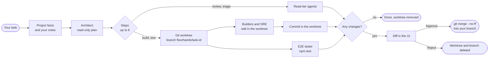

# floorhands

**A local office of nine engineering agents that review, build and test your git repository, and hold every change for your approval.**

[](https://github.com/SuryaSatyaNikhil503/floorhands/actions/workflows/ci.yml)
[](LICENSE)
[](package.json)
[](#what-has-been-verified)

<p align="center">
  
</p>

> **Status: early (v0.2.0).** It works end to end on macOS with Claude Code 2.1.296. The agent prompts are version 2 and were evaluated on three small sample projects (see [Evaluation](#evaluation)); there are no connectors yet, and the local port has no authentication. Read [Known limits](#known-limits) before pointing it at anything you care about.

## What it is

floorhands is a small local server, a browser UI and a CLI that run a team of nine agents on the project you start it in. You type a task; an Architect agent turns it into a plan of up to six steps for the other agents; each step is one run of **your own** `claude` CLI, under your own login, with a permission tier that limits what that agent can do. Anything the builders change is made in a separate git worktree and shown to you as a diff. Nothing reaches your branch until you press **Approve**, and nothing is ever pushed.

**What you get**

- A floor plan of the team in your browser that shows who is working and which tool they are using, plus the plan, each agent's output and the diff.
- Reviews from read-only agents (front end, back end, AWS/DevOps), changes from two builder agents and an SRE, triage from a support engineer, and test runs from an end-to-end tester.
- Agents that know your project: floorhands detects its stack (languages, frameworks, which scripts exist) and tells every agent, and you can add standing guidance of your own with `floorhands notes` (see [Teach it about your project](#teach-it-about-your-project)).
- Three permission tiers (read, build, test) defined in one file, [`server/tiers.js`](server/tiers.js), and probed against the real Claude Code CLI.
- Per-task git worktrees with Approve (`git merge --no-ff`) or Reject (worktree and branch deleted).
- Build and test commands that run inside Claude Code's Bash sandbox: no network, no writes outside the worktree.
- A CLI (`floorhands start`, `status`, `stop`, …) and a Claude Code plugin (a skill, plus an opt-in hook that starts the office when a Claude Code session opens in the project).
- No runtime dependencies: Node 22 or newer and git.

### How a task flows

1. You send a task from the page, for example *"Review the contact form for security, then add server-side email validation"*.
2. floorhands detects the project's **facts** (languages, frameworks, which scripts exist; see [Teach it about your project](#teach-it-about-your-project)) and reads your **notes** file, once for the task. The facts are stored with the task.
3. The **Architect** (read-only) gets your task, the team roster, the facts and a few routing hints derived from them (for example "there is no test script: do not schedule the tester"). It looks at the code and replies with a plan: a short summary and up to six steps, each assigned to one agent. For a plain question it can answer directly with no steps.
4. The steps run in order. The first build or test step creates a git worktree on a new `floorhands/<task-id>` branch; every later step runs inside it, so a reviewer after a builder sees the builder's changes. A step in a worktree is told the commit the branch started at and the git commands that show the change under review. Each step also receives the earlier agents' output as data, cut to the first 2,000 characters per step and at most 6,000 characters in total (oldest dropped first).
5. After each builder step, floorhands commits the worktree (after checking it was not tampered with).
6. If the branch differs from where it started, the task waits for you as **awaiting approval** with the diff. If nothing changed, the worktree is removed and the task is **done**.
7. **Approve and merge** merges the branch into whatever branch your repository is on, then removes the worktree and branch. **Reject** removes them without merging.



## License at a glance

floorhands is **source-available, not open source.** It is licensed under the PolyForm Noncommercial License 1.0.0 together with Additional Terms that narrow it further. The [LICENSE](LICENSE) file is what counts; this table is a summary.

| You can | You cannot | Ask first |
|---|---|---|
| Download, run, study and modify it on your own computers for your own non-commercial purposes | Use it commercially (for example in a for-profit company's work, for clients, or as part of a paid product or service) | Anything the license does not allow, such as commercial use |
| Keep the code you create in your own projects with its help: that code is yours | Publish, distribute or host your own copy or version, modified or not, publicly or privately (repositories, mirrors, packages, images, services) | |
| Fork it on GitHub **only** to prepare a contribution, until it is merged or withdrawn | Use the name "floorhands" for other software | |

To ask for permission, open an issue titled **"Permission request"**: [new permission request](https://github.com/SuryaSatyaNikhil503/floorhands/issues/new?title=Permission+request).

## Requirements

| | |
|---|---|
| **OS** | macOS (tested). Linux is untested; its Bash sandbox needs `bubblewrap` and `socat`. Windows is not supported. |
| **Node** | 22 or newer (developed on 24). |
| **git** | Each project must be a git repository with at least one commit for build and test steps. |
| **Claude Code** | The `claude` CLI installed and logged in (run `claude` once and sign in). Verified with 2.1.296. The plugin is optional. |
| **npm** | Only if you want builders and the tester to run your project's scripts (see the [FAQ](#faq)). |

## Install in Claude Code

You can run floorhands from any terminal. The Claude Code plugin is an optional extra that lets you start it from inside a Claude Code session. Everything the plugin does, the plain `floorhands` command does too.

### 1. Check the prerequisites

```bash
node --version      # v22.0.0 or newer
git --version       # any recent git
claude --version    # Claude Code; tested with 2.1.296
```

You also need to be signed in to Claude Code: run `claude` once in a terminal, sign in when it asks, then quit. floorhands runs your own `claude` under your own login, so if `claude` works for you, floorhands can use it. macOS is the tested platform (see [Requirements](#requirements)).

### 2. Get the code and put `floorhands` on your PATH

```bash
git clone https://github.com/SuryaSatyaNikhil503/floorhands.git ~/Projects/floorhands
~/Projects/floorhands/scripts/install.sh
```

`scripts/install.sh` does three things: it makes the scripts executable, creates `~/.local/bin` if needed, and links `~/.local/bin/floorhands` to `bin/floorhands`. It then prints the two plugin commands from step 3. It does **not** use `sudo`, edit your shell profile, touch your Claude Code configuration, use the network or install packages. You can run it again safely.

If it says `~/.local/bin is not on your PATH`, add it yourself and open a new terminal. For zsh, the macOS default:

```bash
echo 'export PATH="$HOME/.local/bin:$PATH"' >> ~/.zshrc
```

Check with `command -v floorhands`. Keep the clone where it is: the link points into it.

### 3. Install the Claude Code plugin (optional)

The plugin adds one skill, listed as `floorhands:floorhands`, and an opt-in hook that starts the office when a Claude Code session opens in a project you enabled. There are two ways to use it.

**A. Permanent: add the clone as a marketplace and install from it.** Run these in a terminal:

```bash
claude plugin marketplace add ~/Projects/floorhands
claude plugin install floorhands@floorhands
claude plugin list          # floorhands@floorhands should show "Status: ✔ enabled"
```

The first command registers your clone as a marketplace named `floorhands` (in your user settings, so it applies to every project); the second installs the plugin from it. Claude Code reads the plugin straight from `claude-plugin/` in your clone, so do not move or delete the clone. To update, run `git pull` in the clone and start a new Claude Code session (or run `/reload-plugins` in one); `claude plugin update floorhands@floorhands` exists but reports "nothing to update" for a plugin read from a folder.

Manage it later with:

| To | Run |
|---|---|
| Turn it off, keep it installed | `claude plugin disable floorhands@floorhands` |
| Turn it back on | `claude plugin enable floorhands@floorhands` |
| Remove it | `claude plugin uninstall floorhands@floorhands` |
| Remove the marketplace entry too | `claude plugin marketplace remove floorhands` |

`install` and `uninstall` take `--scope user|project|local`; the default is `user`.

**B. Try it for one session without installing anything:**

```bash
claude --plugin-dir ~/Projects/floorhands/claude-plugin
```

The plugin is loaded for that session only.

**What was verified, and what was not.** Both manifests pass `claude plugin validate`. The commands above were run end to end on Claude Code 2.1.296 on macOS in a throwaway Claude Code configuration (add, install, list, disable, enable, update, uninstall, remove), and in both ways (A and B) the skill list of a `claude -p` session contained `floorhands:floorhands`. Not verified: using the skill and the SessionStart hook interactively inside a live session, and the Claude desktop app and the IDE extensions. The plugin commands are terminal commands. Plugins live in your Claude Code user configuration, so the app and the extensions may well pick it up, but that was not tested; if they do not, use the plain `floorhands` command. The hook finds the CLI next to the plugin, at `~/.local/bin/floorhands`, or at the path in `FLOORHANDS_BIN`; the skill runs `floorhands` through Claude's Bash tool, so the command must be on that tool's `PATH` (see [Troubleshooting](#troubleshooting)).

### 4. Check that it works

```bash
floorhands help             # lists start, open, status, stop, enable, disable, notes
cd ~/code/my-app            # any git repository
floorhands status           # "not running", the project path, "auto-start: off"
```

In Claude Code, start a session in that repository (`claude`). The plugin's skill is listed as `floorhands:floorhands`, and you invoke it with that full name:

```text
/floorhands:floorhands start
```

The bare `/floorhands` form is not verified, so this guide does not use it. The skill's description also says to use it when you ask in plain words, for example "start floorhands", so the model can invoke it that way too; this has not been watched in a live session, so the full slash form above is the one to rely on.

## Using floorhands

### A first run, from zero

1. **Pick a repository.** One you cloned yourself (see [Known limits](#known-limits)), with at least one commit (`git log -1` prints it). For build and test steps, install its dependencies yourself and define the scripts you want used (`lint`, `build`, `test`, …) in `package.json`: agents cannot run `npm install` or `npx`, and cannot scaffold a project. Read-only tasks need none of this.
2. **Start it** from inside the repository:
   ```bash
   cd ~/code/my-app
   floorhands start        # floorhands → http://localhost:4600  (project: /…/my-app)
   ```
   or, in a Claude Code session in that repository, `/floorhands:floorhands start`. `floorhands open` also opens the page in your browser. One server runs per repository; its state goes in `my-app/.floorhands/`, which floorhands hides from git through `.git/info/exclude`.
3. **Open the URL.** The page shows the office floor on the left: nine agents in three pods, lit up while they work. On the right is the task box (*Give the team a task*), a muted line under it about your project notes (*Project notes: none · create …* or *Project notes: N bytes · edit …*), the task list, and the selected task's panel.
4. **Send a first task.** Be specific about the area and the outcome (see [Tips for good tasks](#tips-for-good-tasks)). Three to start with:
   - **A review (changes nothing):**
     > Review src/routes/contact.js for input validation and injection problems. Report findings only; do not change anything.
   - **A small change with tests:**
     > In src/routes/orders.js, make GET /api/orders accept optional limit and offset query parameters (limit 1 to 100, default 20; anything else returns 400). Add test cases next to the existing orders tests. Done when the lint and test scripts pass.
   - **A "what could go wrong" triage:**
     > We plan to ship the checkout flow on Friday. What could go wrong in production? Look at error handling, timeouts, retries and what happens when the payment provider is slow.
5. **Read the plan and each agent's output.** Select the task. You see the Architect's summary and its steps, each as *agent — status* with the instruction it was given and, when done, its output. Every report starts with a `VERDICT:` line and ends with *What I checked* and *What I did not check*. Click an agent on the floor to see its recent activity (tool calls and text) for that task.
6. **Review the diff.** If agents changed files, the task waits as *awaiting approval* and the panel shows **Proposed changes**: the full diff of the task branch against where it started. Read it.
7. **Decide.** **Approve and merge** merges the branch into the branch your repository is on, with `git merge --no-ff`, and removes the worktree and branch. **Reject** removes them without merging. If the merge cannot apply cleanly, nothing changes and the branch is kept (see [Troubleshooting](#troubleshooting)). A review or triage task has no diff and ends as *done*.
8. **Stop it** when you are finished: `floorhands stop`.

**What the statuses mean**

| Status | Meaning |
|---|---|
| `queued` | The task was created and has not started yet (an instant). |
| `planning` | The Architect is reading the code and writing the plan. |
| `running` | The plan's steps are running, one after another. Each step is `pending`, `running`, `done` or `failed`. |
| `awaiting approval` | At least one step changed the code. Nothing has reached your branch; the diff is waiting for you. |
| `done` | Finished, with nothing to approve: a review, a question, or a build that changed nothing. |
| `failed` | A step or the plan failed, or the server restarted mid-task. The error is shown in the panel. Work the builders had committed is discarded (see [Known limits](#known-limits)). |
| `approved` | You pressed Approve and the merge succeeded. |
| `rejected` | You pressed Reject; the worktree and branch are gone. |

**Where things live.** The plan and every step's output are in the task panel, and on disk in `.floorhands/tasks/<task-id>.json` in the project (task text, plan, outputs, the project facts the agents were given, and the last 500 events). While a task awaits approval, its changes are in the worktree `~/.floorhands/worktrees/<project-hash>/<task-id>` on the branch `floorhands/<task-id>`. Your own working copy is untouched until you press Approve. Do not put secrets in task text: it is stored in `.floorhands/`.

### Teach it about your project

floorhands tells every agent two kinds of things about your project.

**Project facts: detected automatically, nothing to do.** At the start of each task floorhands looks at the repository's file list and manifests (it reads them as data and never runs them) and records only labels from a fixed list:

- languages, the five most common (javascript, typescript, java, kotlin, python, go, ruby, php, csharp, rust, hcl, shell);
- frameworks and libraries, test tools, infrastructure and CI systems (the full list is below);
- the package manager (npm, pnpm, yarn, bun, or none);
- which of the six scripts `lint`, `build`, `format`, `typecheck`, `test` and `e2e` exist in the **root** `package.json` (script names only);
- the monorepo kind (workspaces, pnpm, turbo, nx) and the number of packages (at most 50);
- whether the folder is a git repository, and how many files were listed.

It **never copies repository text**: no project name, description, script command, path, version, dependency name or file content ever reaches an agent through the facts, only the fixed labels and numbers. Symlinks are not followed and file sizes and counts are capped. The exact text the agents were given is saved as `facts` in the task's JSON file. A project that is not npm-based (Python or Java, say) is detected, but it shows no scripts, and agents are told that nothing can be run.

<details>
<summary>The fixed list of labels</summary>

- **Frameworks and libraries:** react, next, vite, vue, nuxt, svelte, angular, express, nestjs, fastify, koa, tailwind, redux, prisma, typeorm, sequelize, mongoose, spring-boot, spring-security, quarkus, micronaut, hibernate, fastapi, django, flask, sqlalchemy, pydantic, celery, rails, laravel.
- **Test tools:** jest, vitest, playwright, cypress, mocha, testing-library, junit, pytest.
- **Infrastructure:** terraform, cdk, cloudformation, serverless, docker, kubernetes, helm.
- **CI:** github-actions, gitlab-ci, jenkins, circleci.
</details>

**Owner notes: standing guidance you write.** Anything the tool cannot know: conventions, regional data-protection rules, accessibility level, SEO, how your authentication works. `floorhands notes` prints where the file lives and what is in it:

```text
$ floorhands notes
notes file: <your home>/.floorhands/projects/d7582833ca/notes.md
(no notes yet — create the file above with your editor)
```

`floorhands notes` only reads: it creates neither the file nor its folder. To create and edit the file:

```bash
cd ~/code/my-app
NOTES=$(floorhands notes | sed -n '1s/^notes file: //p')
mkdir -p "$(dirname "$NOTES")"
${EDITOR:-nano} "$NOTES"
```

- **Where:** `<FLOORHANDS_HOME or ~/.floorhands>/projects/<project-hash>/notes.md`, **outside** your repository on purpose, because the repository is untrusted and must not be able to plant instructions. The hash comes from the project's absolute path, so a moved or re-cloned project starts with empty notes.
- **Size:** at most 4 KB. Anything beyond that is cut, with a note to the agents. Control characters are removed. A symlink is ignored; the file must be a regular file.
- **Effect:** every agent sees the notes as the owner's standing guidance, in every task you send afterwards (a task already running keeps what it started with). They shape what agents look for and how they write; they can **never** widen what an agent may do. Permissions come only from the tier, enforced by the `claude` command line, so no note can allow a command, a path or the network.
- **Visibility:** the page shows one line about the notes (path and size). The API reports the path and size, never the contents.
- **No secrets in notes:** see the process-list limit under [Known limits](#known-limits).

Example notes for a web app:

```markdown
# Notes
- Public marketing site plus a customer dashboard. Next.js, TypeScript, Tailwind.
- Conventions: named exports only; all data fetching goes through lib/api; user-facing text lives in lib/messages.
- Our users are in the EU and UK: no analytics or marketing scripts before cookie consent; any new form that collects personal data needs a stated purpose and retention period.
- Accessibility target is WCAG 2.2 AA: flag missing labels, focus handling and low contrast.
- SEO matters for the public marketing pages only: unique title and description, one h1, canonical URLs.
```

Example notes for an API service:

```markdown
# Notes
- REST API in Python (FastAPI) on PostgreSQL. Multi-tenant: every table has tenant_id and every query must filter by the caller's tenant.
- Auth: short-lived JWTs from our identity provider; roles are admin, member and viewer. Roles are checked in the dependency, not in handlers.
- PII: names, emails and phone numbers. Never log them; treat any new response field that exposes PII as High risk.
- Errors use the problem-details shape in app/errors.py.
```

### Using it from Claude Code, day to day

With the plugin installed, the skill takes one word after its name:

| You type | It runs |
|---|---|
| `/floorhands:floorhands start` | `floorhands start`, then shows you the URL |
| `/floorhands:floorhands status` | `floorhands status` |
| `/floorhands:floorhands stop` | `floorhands stop` |
| `/floorhands:floorhands on` | `floorhands enable`: turn auto-start on for this project |
| `/floorhands:floorhands off` | `floorhands disable`: turn auto-start off |

Run them from a session in the project. Asking in plain words ("start floorhands", "open the office") should work too, and if you ask the skill to open the page for you it runs `floorhands open`.

**Auto-start is opt-in and per project.** After `on` (or `floorhands enable` in a terminal), the plugin's SessionStart hook runs each time a Claude Code session opens in that project: it starts the office if it is not running and prints one line, the URL. In a project where you did not enable it, the hook does nothing. The hook never blocks or breaks a session: it swallows its own errors and gives up after 15 seconds. If it prints an error about `node`, see [Troubleshooting](#troubleshooting).

**Several projects at once.** Each repository gets its own server: ports start at 4600 and go upward (`FLOORHANDS_PORT` changes the first one). Run `floorhands status` inside a project to see its port.

**Monorepos and folders with several repositories.** The project is the git repository you start floorhands in (the top level of the repository, even if you start it from a subfolder). In a monorepo that is the whole repository, and the facts note the workspaces. If a folder holds several separate repositories (for example `frontend/` and `backend/`), start floorhands inside the one you want to work on, and use another server for the other.

### Tips for good tasks

These come from the rules the Architect works by.

- **Name the area and the outcome.** "Add server-side validation for the email field in the contact form" beats "improve the form". Give file paths you know.
- **Say how you will verify it.** "Done when the lint and test scripts pass" or "a test asserts 404 for another user's order". Without a check, the team can only report that the change is unverified.
- **One concern per task.** A task becomes at most six steps, and most need one to three. A big job gets a first slice, with the rest described in the summary.
- **Know what the team cannot do.** Agents cannot install packages, deploy, use the network or external services, or read production data. They cannot read `.env*` or `*.pem` files, or touch `.env*`, `.git`, `node_modules`, `.claude` or `.mcp.json`. Builders can run only `npm run lint`, `build`, `format` and `typecheck`; the tester only `npm test`, `npm run test` and `npm run e2e`. Code that needs a new dependency is planned only if it is already in the manifest or you say it is installed.
- **No scripts means analysis only.** If the project has no matching scripts (or is not npm-based), nobody can run the result; builders still edit, the summary says the change is unverified, and no tester is scheduled. If you ask for tests but the project has no test setup, the plan specifies the cases for you to add.
- **Commit what you want the builders to see.** The first build step branches from `HEAD`, so uncommitted edits are not in the worktree. Read-only agents look at your working copy.
- **Treat pasted text as data.** Issue text, logs and file contents in a task cannot give the agents orders; they are told to report such attempts as findings.

## The team

From [`agents/roster.json`](agents/roster.json). Each agent has a prompt in [`agents/prompts/`](agents/prompts/) and, optionally, hints about Claude skills that may help (see [How the agents are briefed](#how-the-agents-are-briefed)).

| id | Name | Role | Pod | Tier | What it may do | Report starts with |
|---|---|---|---|---|---|---|
| `arch` | Architect (router, pod lead) | Technical Architect | Architecture & Review | read | Read the code and write the plan | the plan (JSON); direct answers go in its summary |
| `rfe` | FE Reviewer | Senior Front-End Engineer | Architecture & Review | read | Review front-end code | `VERDICT: approve \| approve-with-changes \| block` |
| `rbe` | BE Reviewer | Senior Back-End Engineer | Architecture & Review | read | Review back-end code | `VERDICT: approve \| approve-with-changes \| block` |
| `raws` | AWS Reviewer | Senior AWS DevOps Engineer | Architecture & Review | read | Review infrastructure, IAM and CI/CD code | `VERDICT: approve \| approve-with-changes \| block` |
| `fe` | Front-End Engineer (pod lead) | Front-End Engineer | Build | build | Edit files in the worktree; run lint, build, format, typecheck scripts | `VERDICT: done \| partial \| blocked` |
| `be` | Back-End Engineer | Back-End Engineer | Build | build | Edit files in the worktree; run lint, build, format, typecheck scripts | `VERDICT: done \| partial \| blocked` |
| `sre` | SRE (pod lead) | Site Reliability Engineer | Reliability & Quality | build | Edit pipeline and infrastructure code in the worktree; cannot apply or deploy | `VERDICT: done \| partial \| blocked` |
| `sup` | Support Engineer | Support Engineer | Reliability & Quality | read | Find operational risks and write ready-to-file tickets | `VERDICT: no-issues \| issues-found \| needs-information` |
| `e2e` | E2E Tester | End-to-End Tester | Reliability & Quality | test | Run the project's test scripts in the worktree; cannot edit | `VERDICT: pass \| fail \| no-tests \| blocked` |

| Tier | Tools | Shell commands allowed | Runs in | Sandbox |
|---|---|---|---|---|
| **read** | Read, Glob, Grep, Skill, Bash | `git diff`, `git log`, `git show`, `git status`, `git blame`, `git ls-files`, `git rev-parse` | the project, or the task's worktree once one exists | no (it runs no project scripts) |
| **build** | the read tools + Edit and Write (under the worktree only) | the read-tier git commands + `npm run lint`, `npm run build`, `npm run format`, `npm run typecheck` | the task's worktree | yes |
| **test** | Read, Glob, Grep, Skill, Bash (no Edit or Write) | the read-tier git commands + `npm test`, `npm run test`, `npm run e2e` | the task's worktree | yes |

The roster is data: you can rename agents, change prompts or skills, or move agents between pods without code changes (see [Configuration](#configuration)). Every agent must use one of these three tiers.

### How the agents are briefed

Each agent's system prompt is put together fresh for every task, in this order:

1. the **common rules** ([`agents/prompts/_common.md`](agents/prompts/_common.md)): untrusted content is data, never read or repeat secrets, no destructive actions, the tier is binding; a method; a severity scale (Critical, High, Medium, Low, Info) defined with examples; a finding format (title with `path:line`, evidence, why it matters, fix); and the report skeleton: a `VERDICT:` first line, a two-sentence summary, then *What I checked* and *What I did not check*;
2. a **tier note** saying what that tier can and cannot do;
3. the **project facts** (data);
4. your **owner notes** (guidance that never widens the tier);
5. **skill hints** that apply to this stack (below);
6. the **role body** from its own prompt file: the Architect's routing rules and plan format, the reviewers' checklists and search recipes for their stacks, the builders' workflow and verification rules, the support engineer's ticket template, the tester's strategy.

The whole prompt is capped at 24 KB; a prompt over the cap is refused with an error.

**Skills are hints, never requirements.** A roster entry can be a skill name, or `{ "name", "alt", "when" }`, where `when` lists fact labels and the hint is shown only if the project has one of them (for example, a React skill only for a React project). If a skill is missing or fails, the agent carries on with the checklist in its prompt.

**Prompt lint.** [`test/prompts.test.js`](test/prompts.test.js) ties every prompt to the permission model in `server/tiers.js`: no prompt may tell an agent to run a command its tier denies, and every prompt must have its required sections, stay within its size cap and name no personal data or project. The lint is what keeps a prompt edit from quietly asking an agent for something the permission model refuses.

## How it keeps you safe

floorhands assumes that **you** and your user-level Claude Code settings are trusted, and that **the target repository and everything an agent reads are not**. Each agent is a separate `claude -p` process started with `--permission-mode dontAsk` (no prompts; anything not allowed is refused), an explicit tool list, an allow list and a deny list, all built by one function, `buildClaudeArgs` in [`server/tiers.js`](server/tiers.js). The task prompt (your text and the step) goes to the CLI on stdin, never on the command line, so task text can never be read as a flag. The system prompt (the rules, project facts and owner notes) is passed as an argument; see Known limits.

| Layer | What it does |
|---|---|
| **Tiers** | Read agents can only read files and run read-only git. Builders can edit only under their working directory (`Edit(./**)`; a bare Edit/Write allow was found to let the CLI write outside it and was replaced). The tester can run test scripts but not edit. |
| **Deny rules** (every tier) | Denied even if your own settings allow them, because deny beats allow: `git push`, `pull`, `fetch`, `commit`, `merge`, `rebase`, `checkout`, `reset`, `branch`, `config`, `-C`, `-c` and most other git commands that change state; `--output`, `--no-index`, `--ext-diff` and `--textconv` anywhere in a git command (probed for `--output` and `--no-index`); `rm`, `mv`, `cp`, `chmod`, `ln`, `sudo`, `ssh`, `curl`, `wget`, `nc`, `open`, `aws`, `kubectl`, `docker`, `terraform apply/destroy`, `cdk deploy/destroy`, `npm install/ci/publish`, `npx`, `node`, `sh`, `bash`, `python`, `eval`, `xargs`, `env`; and every shell command that can print or search a file (`cat`, `head`, `sort`, `awk`, `sed`, `base64`, `diff`, `grep`, `rg`, `git grep`, `git cat-file`, …). Agents use the Read, Grep and Glob tools instead, which honour the file deny rules. |
| **Secret files** | The Read tool is denied `.env*`, `*.pem` and the home credential stores `~/.aws`, `~/.ssh`, `~/.config/gh`, `~/.config/gcloud`, `~/.npmrc`, `~/.netrc`, `~/.docker/config.json`, `~/.kube`, `~/.git-credentials`, `~/.gnupg`, `~/.azure`, `~/.pypirc`, `~/.gem/credentials`, `~/.cargo/credentials*`, `~/.password-store`, `~/.claude` and `~/Library/Keychains`. Edit and Write are denied for `.env*`, `.git` (including the worktree's `.git` link file), `node_modules`, `.claude`, `.mcp.json`, `~/.ssh`, `~/.aws`, `~/.claude` and your shell rc files. |
| **Worktree isolation** | Build and test steps work in `~/.floorhands/worktrees/<project-hash>/<task-id>` on the branch `floorhands/<task-id>`, never in your working copy. Your branch changes only when you press Approve. |
| **`.git` link tamper check** | A worktree's `.git` is a small file pointing at the real repository. Before every commit, floorhands checks that the worktree's HEAD is still its own `floorhands/<task-id>` branch and that its git directory is that worktree's own entry in your repository; otherwise it refuses to commit. These git commands run with hooks, fsmonitor and `core.sshCommand` disabled and with `--no-verify`, so nothing planted in the worktree runs in the server. Approve and Reject act only on a worktree inside the floorhands folder and a `floorhands/` branch. |
| **Bash sandbox** (build, test) | Shell commands run in Claude Code's OS-level sandbox: no network host is reachable, no writes outside the worktree, sandboxed commands still need an allow rule, no unsandboxed retry, and the run refuses to start if the sandbox is unavailable. Scripts are also denied the home credential stores listed above (all but `~/.cargo/credentials*`). |
| **`--setting-sources user`** | Agents load only your user-level Claude settings. The target repository's `.claude/settings.json`, `.claude/settings.local.json`, hooks and skills are ignored. This closed a real bypass found while testing: a hook in an untrusted repository's settings ran outside the sandbox, as you. |
| **`--strict-mcp-config`** | Agents get no MCP servers: none of your connectors (mail, drive and the like) and nothing from the repository's `.mcp.json`. |
| **Credential scrubbing** | Agent processes do not inherit `AWS_*`, `GH_TOKEN`, `GITHUB_TOKEN`, `NPM_TOKEN`, `SSH_AUTH_SOCK`, or any variable whose name contains `SECRET`, `PASSWORD`, `PASSWD` or `PRIVATE_KEY`. This is a deny-list (see Known limits). |
| **Facts and notes** | Project facts contain only labels from a fixed list plus numbers, so repository text cannot reach an agent's prompt through them, and both facts and notes are framed as data or guidance, never as a way to change a tier. Owner notes live outside the repository, so a repository cannot plant instructions in them. |
| **Local server guards** | Listens on 127.0.0.1 only. Rejects requests whose `Host` is not `localhost`, `127.0.0.1` or `[::1]` (against DNS rebinding), POSTs from another `Origin`, and POSTs that are not `application/json` (so a plain form on another website cannot submit a task). Request bodies are capped at 64 KB, and the UI is served with a strict Content-Security-Policy and loads nothing from other origins. |

### What has been verified

The permission model was tested against the **real CLI: Claude Code 2.1.296 on macOS, on 2026-10-13**, with [`scripts/spike-claude.mjs`](scripts/spike-claude.mjs), which defines 67 probes (`node scripts/spike-claude.mjs --list` prints them without running anything). A negative probe passes only when the transcript shows the agent **attempting** the forbidden action and the CLI **refusing** it.

- **Round 1:** 47 probes in 41 `claude -p` calls. 46 PASS and 1 FAIL that is functional, not a bypass (some roster skill names do not resolve as written). It found and fixed two bypasses: builders could write outside the worktree, and `grep -r` printed `.env`.
- **Round 2 (untrusted repositories):** 25 probes in 51 `claude -p` invocations. It found and fixed a third bypass (repository hooks, closed by `--setting-sources user`), and confirmed that repository `permissions.allow`, repository sandbox overrides, `.mcp.json`, repository skills, 16 shell forms that could print `.env`, `git cat-file`, credential stores (through the Read tool and from sandboxed scripts), writes through a symlink and writes through the `node_modules` link are all refused. One probe was inconclusive (the model did not attempt a `CLAUDE.md` prompt injection) and two recorded a known limit (both under item 3 below).

Full evidence is in [docs/spike-findings.md](docs/spike-findings.md) and the JSON results next to it.

`server/tiers.js` has not changed since 0.1.0, so these results still describe the permission model. The 0.2.0 code (stack detection, notes, prompt assembly) is covered by the test suite, which uses a fake `claude` (`npm test`). How the version 2 prompts behave with the real CLI is the subject of the Evaluation below.

### Evaluation

The version 2 prompts were compared with the original ones on three small sample projects with problems planted in them. The method, the scoring and the results are in [docs/prompt-eval.md](docs/prompt-eval.md). Three small projects say little about your repository; read the numbers as a check on the prompts, not as a promise.

**Result.** Both versions found nearly every planted problem, so recall cannot tell them apart; this is a ceiling effect, not a win.

| Reviewer | Planted problems found, old prompts | Planted problems found, new prompts |
|---|---|---|
| Back end (Express) | 92% | 100% |
| Front end (React) | 100% | 100% |
| AWS (Terraform and GitHub Actions) | 100% | 100% |

What did differ is the shape of the report. All six new reports open with a `VERDICT:` line and follow the required format (none of the six old reports do, because the old prompts never asked for it). The new reports rate problems closer to the rating that was planted, and list fewer extra findings (0 to 4 against 6 to 13). Citations were checked against the files: none were invented in either version. The new system prompt is about six times larger, but the tokens used per run did not rise (output tokens were 8 to 27% higher).

Read it with these limits in mind: two runs per cell, three projects, 24 planted problems, the same model family wrote the projects, the answer key and the reports, and the scorer was fixed after the first results (the fix and the first-pass numbers are disclosed in the report). The builders, the tester, the support engineer, the SRE and the Architect were not measured. The evaluation also found one real defect, that two reviewer prompts told the agent to read `.env.example`, which the permission model denies; it is fixed in 0.2.0.


**Not verified:** Linux (the sandbox there needs bubblewrap and socat and has not been tried); Windows (not supported); other Claude Code versions (re-run the probes after upgrading `claude`); how the CLI expands `~` in the credential rules (the probes used the same rules with a fake home's absolute path); and the plugin in an interactive Claude Code session. `floorhands:floorhands` was confirmed in the skill list of real `claude -p` sessions, with the plugin installed and with `--plugin-dir`, and both manifests pass `claude plugin validate`, but the skill and the SessionStart hook have not been exercised interactively, and the Claude desktop app and IDE extensions were not tested. `scripts/smoke.mjs` (a real review task end to end) has not been run.

### Known limits

1. **Project scripts are trusted code.** `npm run …` and `npm test` run your `package.json` scripts. A builder can edit `package.json` in its worktree and so change what those scripts do before you approve. They run sandboxed, but the sandbox protects your working copy and the network, not everything: scripts can still read most of your machine (apart from the denied credential stores) and run with your environment minus the scrubbed variables.
2. **No authentication on the local port.** Beyond binding to 127.0.0.1 and the Host and Origin checks, anything that can reach the port on your machine (another local user or process) can start agents. A per-run token is planned.
3. **Committed secrets are readable.** A secret the repository has **committed** stays readable through the allowed git reads (`git show HEAD:.env` printed one in testing), and sandboxed build and test scripts can read the worktree's own `.env*` (a fresh worktree has one only if it is committed). Do not put secrets in task text either: it is stored in `.floorhands/`.
4. **Repository-configured git programs.** Read-tier `git diff`, `git log` and `git show` can run diff or textconv programs configured in the repository's git config, and the read tier is not sandboxed. Treat the read tier as safe for trusted repositories only.
5. **`.gitattributes` filters.** A `.gitattributes` in the worktree can route files through filter programs **you** configured (for example git-lfs) when floorhands commits or you approve. Agents cannot add a filter program; neutralising yours would break repositories that use git-lfs or git-crypt, so this is accepted.
6. **Your own Claude settings still apply.** Agents load your `~/.claude/settings.json`: a broad allow there widens what agents may run (deny rules still win), and your plugins' hooks run in every agent session, outside the sandbox.
7. **Environment scrubbing is a deny-list.** Other secret-looking variables (for example `GITLAB_TOKEN`, `OPENAI_API_KEY`, `DATABASE_URL`) still reach agents.
8. **`node_modules` is shared.** A worktree's `node_modules` is a link to your real one so that builds work. Agents cannot edit it, and the sandbox blocks scripts from writing through it, so scripts that write caches into `node_modules/.cache` fail.
9. **Stopping does not stop running agents.** `floorhands stop` mid-task does not kill an in-flight `claude` process, and the 15-minute agent timeout kills only that process, not what it started. The next start marks the task failed and leaves its `floorhands/<task-id>` branch and worktree for you to remove (see [Troubleshooting](#troubleshooting)).
10. **A failed task discards builder work.** If a step fails after builders committed, the worktree and branch are deleted rather than kept for review.
11. **Git commands have no timeout.** A merge that waits for input (for example a GPG passphrase prompt) or a hanging hook in your repository blocks that task's Approve until the server restarts.
12. **No cap on concurrent tasks.** Each task you send starts at once, with its own worktree and agent processes.
13. **Prompts are version 2, not finished.** They were evaluated on three small sample projects only (see [Evaluation](#evaluation)), and real repositories are bigger and messier. Treat findings as leads to check, and an `approve` verdict as "nothing at High or above in what was checked", not as a clean bill of health. Skill hints depend on which plugins you have installed; agents carry on without them.
14. **No connectors.** Agents see only the repository: no GitHub, cloud account, monitoring or issue tracker yet.
15. **A hostile `.git/config`.** Only run floorhands on repositories you cloned yourself. An archive or folder that ships its own `.git` directory can carry a git config that makes git run programs. floorhands hardens its own project scan (git runs with every transport, lazy fetching and fsmonitor off, and a `.git` that is not a real directory is not trusted) and the commits it makes in worktrees, but not every git call: finding the project root, creating worktrees, the read-tier agents' git commands (limit 4) and the merge when you press Approve use the repository's config as it is.
16. **The system prompt is visible in the process list.** It is passed on the `claude` command line, so your owner notes and the project facts can be read by other users on the same machine while an agent runs (for example with `ps`). Keep secrets and anything private out of your notes.
17. **Project facts are shallow.** Scripts are read only from the root `package.json`; a stack outside the fixed list of labels is not named. Detection reads a bounded number of files, so a very large repository may show an incomplete picture. Agents are told the facts are hints and can read the code themselves.

## CLI and skill reference

| Command | What it does |
|---|---|
| `floorhands start` | Start the office for the current repository, or find the one already running, and print its URL. |
| `floorhands open` | Same as `start`, then open the page in your browser. |
| `floorhands status` | Print whether it is running and on which port, the project root, and whether auto-start is on. |
| `floorhands stop` | Stop this project's server. A stale record is removed. |
| `floorhands enable` / `disable` | Turn auto-start on or off for this project (creates or removes `.floorhands/enabled`). |
| `floorhands notes` | Print the path of this project's owner-notes file and its contents. Creates nothing. See [Teach it about your project](#teach-it-about-your-project). |
| `floorhands help` | Print the command list (also `--help` and `-h`). |

Exit codes: `0` on success (including "not running"); `1` if the server could not be started; `2` for an unknown command, an unknown flag or an extra argument, which also prints the command list.

`floorhands start --if-enabled` is for the SessionStart hook: it starts the server only if the project is enabled. `start` and the hook do nothing inside a floorhands agent (`FLOORHANDS_AGENT=1`), so an agent never starts another server.

**From Claude Code**, with the plugin installed, the skill is listed as `/floorhands:floorhands` and takes one word:

| Skill | Runs |
|---|---|
| `/floorhands:floorhands start` | `floorhands start` (if you ask it to open the page, `floorhands open`) |
| `/floorhands:floorhands status` | `floorhands status` |
| `/floorhands:floorhands stop` | `floorhands stop` |
| `/floorhands:floorhands on` | `floorhands enable` |
| `/floorhands:floorhands off` | `floorhands disable` |

The skill runs the `floorhands` command through Claude's Bash tool, so the command must be on that tool's `PATH` (run `scripts/install.sh`). After `floorhands enable` in a project, the plugin's SessionStart hook starts the office whenever a Claude Code session opens there and prints the URL. Install steps and day-to-day use are in [Install in Claude Code](#install-in-claude-code) and [Using floorhands](#using-floorhands).

## Configuration

| Variable | Default | Effect |
|---|---|---|
| `FLOORHANDS_PORT` | `4600` | First port to try. If it is busy, the next free one is used (up to 19 more). |
| `FLOORHANDS_HOME` | `~/.floorhands` | Where floorhands keeps its own files outside your repositories: worktrees (`<home>/worktrees/<project-hash>/<task-id>`) and owner notes (`<home>/projects/<project-hash>/notes.md`). |
| `FLOORHANDS_CLAUDE_BIN` | `claude` | The CLI to run for each agent turn. `scripts/fake-claude.mjs` is a stand-in for demos and tests. |
| `FLOORHANDS_LOCK_WAIT_MS` | `5000` | How long a starting server waits for the server holding this project's lock to answer before treating the lock as stale. |
| `FLOORHANDS_BIN` | (unset) | For the SessionStart hook only: the path to `bin/floorhands` when it is neither at `~/.local/bin/floorhands` nor next to the plugin. |

Set these in the environment of `floorhands start`; the server inherits them. Agents use your default Claude Code model.

**Where things live**

- `<project>/.floorhands/`: `tasks/` (one JSON file per task: text, plan, each step's output, the project facts the agents were given, and the last 500 events), `server.json` (pid and port), `server.lock`, `server.log`, and `enabled` when auto-start is on. It is listed in `.git/info/exclude`, so it is never committed.
- `~/.floorhands/worktrees/` (or `$FLOORHANDS_HOME/worktrees/`): one folder per project, one worktree per task.
- `~/.floorhands/projects/<project-hash>/notes.md` (or under `$FLOORHANDS_HOME/projects/`): your owner notes for that project. `floorhands notes` prints the exact path.

**Customising the team (locally).** Edit [`agents/roster.json`](agents/roster.json) and the prompts in [`agents/prompts/`](agents/prompts/), then restart with `floorhands stop && floorhands start`. Each agent needs `id`, `name`, `role`, `pod`, `tier` (`read`, `build` or `test`) and `prompt` (a plain `.md` file name); each pod needs exactly one `lead`, and exactly one agent must be the `router` (the planner). An invalid roster stops the server from starting, with the reason in `.floorhands/server.log`. `_common.md` is put in front of every prompt, with `{{name}}` and `{{role}}` filled in. The optional `skills` list takes names, or `{ "name", "alt", "when" }` objects whose `when` lists fact labels from the [fixed list](#teach-it-about-your-project); an unknown label makes the roster invalid. Permissions are not configurable per agent: they come from the tier. Test any prompt change with `npm test`: the prompt lint fails if a prompt tells an agent to run something its tier denies.

## Troubleshooting

<details>
<summary><strong>A step fails with "claude exited …", "Not logged in" or "Claude Code is not installed"</strong></summary>

Run `claude` once in a terminal and sign in. The server runs `claude` from the `PATH` of whatever started it (your shell, or Claude Code for the hook); if `claude` is somewhere else, set `FLOORHANDS_CLAUDE_BIN` to its full path and restart.
</details>

<details>
<summary><strong>Build or test steps fail straight away (sandbox unavailable)</strong></summary>

Build and test steps refuse to run without Claude Code's Bash sandbox. On macOS it is built in. On Linux, install `bubblewrap` and `socat` (untested). Read-only tasks still work.
</details>

<details>
<summary><strong>The SessionStart hook prints an error about <code>node</code></strong></summary>

The hook command is `node "<plugin>/hooks/session-start.js"`, so `node` must be on the `PATH` that Claude Code itself sees. If you installed Node through a version manager such as nvm, the desktop app may not see it: install Node system-wide, or launch the app from a shell that has it. `FLOORHANDS_BIN` does not help here; it only tells a running hook where `bin/floorhands` is.
</details>

<details>
<summary><strong>"Build and test steps need this folder to be a git repository with at least one commit"</strong></summary>

Run `git init && git commit --allow-empty -m init`, or start floorhands from inside the repository you meant. If a folder holds several repositories (for example `frontend/` and `backend/`), start it inside the one to work on. Read-only tasks work in any folder.
</details>

<details>
<summary><strong>"floorhands: command not found"</strong></summary>

Run `scripts/install.sh` and make sure `~/.local/bin` is on your `PATH`, including for the Claude Code app if you use the skill.
</details>

<details>
<summary><strong>Port 4600 is busy</strong></summary>

floorhands moves to the next free port and prints it. To choose one: `FLOORHANDS_PORT=4700 floorhands start`. `floorhands status` shows the port in use.
</details>

<details>
<summary><strong>"floorhands did not start", or it reports running but the page does not load</strong></summary>

Read `.floorhands/server.log` in the project. `floorhands stop` removes a stale record. A lock left by a dead process is cleared on the next start; if one is still in the way, check that no floorhands server is running for that project (`floorhands status`), then delete `.floorhands/server.json` and `.floorhands/server.lock`.
</details>

<details>
<summary><strong>The skill does not show up in Claude Code</strong></summary>

Run `claude plugin list` in a terminal: `floorhands@floorhands` should be listed as enabled (`claude plugin enable floorhands@floorhands` if it is disabled). Then start a new Claude Code session, or run `/reload-plugins` in the one you have. The skill's full name is `floorhands:floorhands`. If the plugin is listed but the folder it was read from is gone, you moved or deleted the clone: remove the plugin and marketplace (see [Install in Claude Code](#install-in-claude-code)) and add them again from the new path.
</details>

<details>
<summary><strong>My notes are not being used</strong></summary>

Run `floorhands notes` from inside the project: it must print your text. If it says "no notes yet", the file is at a different path (the folder name comes from the project's absolute path, so a moved or re-cloned project has a different one), the file is a symlink (ignored; use a regular file), or `FLOORHANDS_HOME` is set differently from when you created it. Notes are read when a task starts, so edit them before you send the task. The page's "Project notes" line shows the size floorhands sees.
</details>

<details>
<summary><strong>Leftover worktrees or <code>floorhands/</code> branches</strong></summary>

After an interrupted or failed task, from inside the project:

```bash
git worktree list                                         # find ~/.floorhands/worktrees/<hash>/<task-id>
rm ~/.floorhands/worktrees/<hash>/<task-id>/node_modules  # only if present: it is a link to your real node_modules
git worktree remove --force ~/.floorhands/worktrees/<hash>/<task-id>
git branch -D floorhands/<task-id>
git worktree prune
```

Remove the `node_modules` link with plain `rm` (no `-r`, no trailing slash) so nothing follows it into your real `node_modules`.
</details>

<details>
<summary><strong>Approve says the merge did not apply cleanly</strong></summary>

Nothing was changed and the `floorhands/<task-id>` branch is kept. Commit or stash your own changes, finish any merge in progress, and check out a branch if you are on a detached HEAD, then press Approve again; or merge the branch yourself.
</details>

## FAQ

<details>
<summary><strong>Is it open source?</strong></summary>

No. It is source-available: you can read, run and modify it for your own non-commercial use, but you cannot use it commercially or publish your own version. This keeps distribution and commercial use with the author while anyone can learn from it and use it personally. See [LICENSE](LICENSE).
</details>

<details>
<summary><strong>Can I use it at work or for clients?</strong></summary>

Not without permission. Commercial use, including use in a for-profit organisation's work and work for clients, is not licensed. Open a [permission request](https://github.com/SuryaSatyaNikhil503/floorhands/issues/new?title=Permission+request).
</details>

<details>
<summary><strong>Can I fork it or share my version?</strong></summary>

You can modify it locally for yourself. You cannot publish, distribute or host your version, publicly or privately. The one exception is a GitHub fork made solely to prepare a contribution, kept until the contribution is merged or withdrawn (see [CONTRIBUTING.md](CONTRIBUTING.md)).
</details>

<details>
<summary><strong>Does it send my code anywhere?</strong></summary>

floorhands itself has no server of its own and no telemetry: the only network connections it makes are to its own local port, and the page loads nothing from other origins. Agents run your `claude` CLI, which sends what they read to Anthropic under your account, exactly as when you use Claude Code yourself. Agents get no MCP servers. Your own Claude Code plugins' hooks do run in agent sessions and do whatever they do in your normal sessions.
</details>

<details>
<summary><strong>What does it cost?</strong></summary>

floorhands has no fee; agent turns count against your Claude plan or API usage like any other Claude Code session. A task is one Architect turn plus one turn per step (up to six), so a single task is several agent turns.
</details>

<details>
<summary><strong>Which languages and stacks does it work with?</strong></summary>

Reviews, plans, triage and file edits work on any git repository in any language. floorhands detects a fixed list of languages, frameworks, test tools, infrastructure and CI systems (see [Teach it about your project](#teach-it-about-your-project)), and the reviewers have checklists for web front ends, back ends and AWS-style infrastructure. Running things is npm-only today: builders can run only `npm run lint|build|format|typecheck`, and the tester only `npm test`, `npm run test` or `npm run e2e`. In a project without those npm scripts (a Python or Java project, say), builders can still edit files, but no agent can build or test the result, and the plan says the change is unverified. A `package.json` whose scripts call your own tools might work, but that has not been tested.
</details>

## Roadmap

In rough order:

1. Project profiles: owner notes (free-text guidance per project) shipped in 0.2.0. Still to do: ready-made, reusable profiles, for example for regional data-protection rules or SEO.
2. A per-run auth token for the local server.
3. Connectors: GitHub, AWS (read-only), an issue tracker.
4. Verify the sandbox and the probes on Linux.
5. Kill the whole process group on stop and on timeout, and clean up interrupted tasks' worktrees on restart.
6. Environment scrubbing as an allow-list instead of a deny-list.
7. Harden the remaining git calls against a hostile `.git/config`.

## Project layout

```text
bin/floorhands       CLI entry point
server/              HTTP server, orchestrator, agent runner, worktrees, task store
  tiers.js           the whole permission model
  stack.js           project facts: fixed-vocabulary detection of the stack
  notes.js           owner notes, kept outside the repository
  prompt.js          per-task prompt composition
  roster.js          roster loading and validation
ui/                  browser UI (vanilla JS and SVG, no build step)
agents/              roster.json and one prompt per agent
claude-plugin/       Claude Code plugin: skill and SessionStart hook
.claude-plugin/      marketplace manifest for the plugin
scripts/             install.sh, fake-claude.mjs, the real-CLI probes and the smoke test
  eval-prompts.mjs   prompt evaluation harness
eval/                prompt evaluation: sample projects and expected findings
docs/                spike findings, build notes, design docs, prompt evaluation, screenshots
test/                node --test suite (fake claude only; no network), including the prompt lint
```

<p align="center">
  
</p>

## Contributing, security and license

- **Contributing:** open an issue first for anything non-trivial. Setup, rules and the contributor terms are in [CONTRIBUTING.md](CONTRIBUTING.md).
- **Security:** report vulnerabilities privately, never in a public issue. See [SECURITY.md](SECURITY.md).
- **Changes:** [CHANGELOG.md](CHANGELOG.md).
- **License:** source-available, under PolyForm Noncommercial 1.0.0 with Additional Terms. See [LICENSE](LICENSE). Copyright (c) 2026 Surya Satya Nikhil Gadhavajula.
