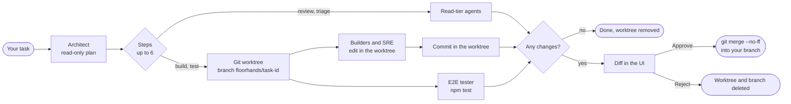

# floorhands

**A local office of nine engineering agents that review, build and test your git repository, and hold every change for your approval.**

[](https://github.com/SuryaSatyaNikhil503/floorhands/actions/workflows/ci.yml)
[](LICENSE)
[](package.json)
[](#what-has-been-verified)

<p align="center">
  
</p>

> **Status: early (v0.1.0).** It works end to end on macOS with Claude Code 2.1.296. The agent prompts are first drafts, there are no connectors yet, and the local port has no authentication. Read [Known limits](#known-limits) before pointing it at anything you care about.

## What it is

floorhands is a small local server, a browser UI and a CLI that run a team of nine agents on the project you start it in. You type a task; an Architect agent turns it into a plan of up to six steps for the other agents; each step is one run of **your own** `claude` CLI, under your own login, with a permission tier that limits what that agent can do. Anything the builders change is made in a separate git worktree and shown to you as a diff. Nothing reaches your branch until you press **Approve**, and nothing is ever pushed.

**What you get**

- A floor plan of the team in your browser that shows who is working and which tool they are using, plus the plan, each agent's output and the diff.
- Reviews from read-only agents (front end, back end, AWS/DevOps), changes from two builder agents and an SRE, triage from a support engineer, and test runs from an end-to-end tester.
- Three permission tiers (read, build, test) defined in one file, [`server/tiers.js`](server/tiers.js), and probed against the real Claude Code CLI.
- Per-task git worktrees with Approve (`git merge --no-ff`) or Reject (worktree and branch deleted).
- Build and test commands that run inside Claude Code's Bash sandbox: no network, no writes outside the worktree.
- A CLI (`floorhands start`, `status`, `stop`, …) and a Claude Code plugin (a skill, plus an opt-in hook that starts the office when a Claude Code session opens in the project).
- No runtime dependencies: Node 22 or newer and git.

### How a task flows

1. You send a task from the page, for example *"Review the contact form for security, then add server-side email validation"*.
2. The **Architect** (read-only) looks at the code and replies with a plan: a short summary and up to six steps, each assigned to one agent. For a plain question it can answer directly with no steps.
3. The steps run in order. The first build or test step creates a git worktree on a new `floorhands/<task-id>` branch; every later step runs inside it, so a reviewer after a builder sees the builder's changes.
4. After each builder step, floorhands commits the worktree (after checking it was not tampered with).
5. If the branch differs from where it started, the task waits for you as **awaiting approval** with the diff. If nothing changed, the worktree is removed and the task is **done**.
6. **Approve and merge** merges the branch into whatever branch your repository is on, then removes the worktree and branch. **Reject** removes them without merging.



## License at a glance

floorhands is **source-available, not open source.** It is licensed under the PolyForm Noncommercial License 1.0.0 together with Additional Terms that narrow it further. The [LICENSE](LICENSE) file is what counts; this table is a summary.

| You can | You cannot | Ask first |
|---|---|---|
| Download, run, study and modify it on your own computers for your own non-commercial purposes | Use it commercially (for example in a for-profit company's work, for clients, or as part of a paid product or service) | Anything the license does not allow, such as commercial use |
| Keep the code you create in your own projects with its help: that code is yours | Publish, distribute or host your own copy or version, modified or not, publicly or privately (repositories, mirrors, packages, images, services) | |
| Fork it on GitHub **only** to prepare a contribution, until it is merged or withdrawn | Use the name "floorhands" for other software | |

To ask for permission, open an issue titled **"Permission request"**: [new permission request](https://github.com/SuryaSatyaNikhil503/floorhands/issues/new?title=Permission+request).

## Requirements

| | |
|---|---|
| **OS** | macOS (tested). Linux is untested; its Bash sandbox needs `bubblewrap` and `socat`. Windows is not supported. |
| **Node** | 22 or newer (developed on 24). |
| **git** | Each project must be a git repository with at least one commit for build and test steps. |
| **Claude Code** | The `claude` CLI installed and logged in (run `claude` once and sign in). Verified with 2.1.296. |
| **npm** | Only if you want builders and the tester to run your project's scripts (see the [FAQ](#faq)). |

## Install

Clone it for your own use. The commands below use `~/Projects/floorhands`, which is also the path the plugin skill suggests when the command is missing.

```bash
git clone https://github.com/SuryaSatyaNikhil503/floorhands.git ~/Projects/floorhands
~/Projects/floorhands/scripts/install.sh
```

`scripts/install.sh` makes the scripts executable and links `~/.local/bin/floorhands` to `bin/floorhands`. It tells you if `~/.local/bin` is not on your `PATH`; if so, add it to your shell profile.

**Claude Code plugin (optional).** It adds the `/floorhands:floorhands` skill and the opt-in SessionStart hook:

```bash
claude plugin marketplace add ~/Projects/floorhands
claude plugin install floorhands@floorhands
```

To try the plugin for one session without installing it: `claude --plugin-dir ~/Projects/floorhands/claude-plugin`.

> These steps change your `PATH` and your Claude Code configuration, so you run them yourself. The manifests pass `claude plugin validate`; the marketplace install itself has not been exercised in testing.

## Quick start

```bash
cd ~/code/my-app            # any git repository with at least one commit
floorhands start            # prints: floorhands → http://localhost:4600  (project: /…/my-app)
```

1. **Start it from inside the repository you want to work on.** One server runs per repository. Its state goes in `my-app/.floorhands/`, which floorhands hides from git through `.git/info/exclude`.
2. **Open the URL** it printed, or run `floorhands open` to start it and open your browser.
3. **Send a task.** For example:
   > Review src/routes/contact.js for input validation and injection problems, then add server-side validation for the email and message fields and make the lint script pass.

   The Architect plans it (for this one, typically: back-end reviewer, back-end engineer, then a reviewer again) and each agent lights up on the floor while it works. Select the task, then click an agent to see its recent activity on that task.
4. **Review the diff.** When the task shows *awaiting approval*, read every step's output and the full diff in the task panel.
5. **Approve and merge** (a `--no-ff` merge into your current branch, with your git identity if one is configured) or **Reject**. Run `floorhands stop` when you are done.

Set the project up yourself before the first build task: dependencies installed, and the scripts you want used (`lint`, `build`, `test`, …) defined in `package.json`. Agents cannot run `npm install` or `npx`, and cannot scaffold a project.

## The team

From [`agents/roster.json`](agents/roster.json). Each agent has a prompt in [`agents/prompts/`](agents/prompts/) and a list of Claude skills it is told to use when they are installed.

| id | Name | Role | Pod | Tier | What it may do |
|---|---|---|---|---|---|
| `arch` | Architect (router, pod lead) | Technical Architect | Architecture & Review | read | Read the code and write the plan |
| `rfe` | FE Reviewer | Senior Front-End Engineer | Architecture & Review | read | Review front-end code |
| `rbe` | BE Reviewer | Senior Back-End Engineer | Architecture & Review | read | Review back-end code |
| `raws` | AWS Reviewer | Senior AWS DevOps Engineer | Architecture & Review | read | Review infrastructure, IAM and CI/CD code |
| `fe` | Front-End Engineer (pod lead) | Front-End Engineer | Build | build | Edit files in the worktree; run lint, build, format, typecheck scripts |
| `be` | Back-End Engineer | Back-End Engineer | Build | build | Edit files in the worktree; run lint, build, format, typecheck scripts |
| `sre` | SRE (pod lead) | Site Reliability Engineer | Reliability & Quality | build | Edit pipeline and infrastructure code in the worktree; cannot apply or deploy |
| `sup` | Support Engineer | Support Engineer | Reliability & Quality | read | Find operational risks and write ready-to-file tickets |
| `e2e` | E2E Tester | End-to-End Tester | Reliability & Quality | test | Run the project's test scripts in the worktree; cannot edit |

| Tier | Tools | Shell commands allowed | Runs in | Sandbox |
|---|---|---|---|---|
| **read** | Read, Glob, Grep, Skill, Bash | `git diff`, `git log`, `git show`, `git status`, `git blame`, `git ls-files`, `git rev-parse` | the project, or the task's worktree once one exists | no (it runs no project scripts) |
| **build** | the read tools + Edit and Write (under the worktree only) | the read-tier git commands + `npm run lint`, `npm run build`, `npm run format`, `npm run typecheck` | the task's worktree | yes |
| **test** | Read, Glob, Grep, Skill, Bash (no Edit or Write) | the read-tier git commands + `npm test`, `npm run test`, `npm run e2e` | the task's worktree | yes |

The roster is data: you can rename agents, change prompts or skills, or move agents between pods without code changes (see [Configuration](#configuration)). Every agent must use one of these three tiers.

## How it keeps you safe

floorhands assumes that **you** and your user-level Claude Code settings are trusted, and that **the target repository and everything an agent reads are not**. Each agent is a separate `claude -p` process started with `--permission-mode dontAsk` (no prompts; anything not allowed is refused), an explicit tool list, an allow list and a deny list, all built by one function, `buildClaudeArgs` in [`server/tiers.js`](server/tiers.js). The prompt goes to the CLI on stdin, never on the command line, so task text can never be read as a flag.

| Layer | What it does |
|---|---|
| **Tiers** | Read agents can only read files and run read-only git. Builders can edit only under their working directory (`Edit(./**)`; a bare Edit/Write allow was found to let the CLI write outside it and was replaced). The tester can run test scripts but not edit. |
| **Deny rules** (every tier) | Denied even if your own settings allow them, because deny beats allow: `git push`, `pull`, `fetch`, `commit`, `merge`, `rebase`, `checkout`, `reset`, `branch`, `config`, `-C`, `-c` and most other git commands that change state; `--output`, `--no-index`, `--ext-diff` and `--textconv` anywhere in a git command (probed for `--output` and `--no-index`); `rm`, `mv`, `cp`, `chmod`, `ln`, `sudo`, `ssh`, `curl`, `wget`, `nc`, `open`, `aws`, `kubectl`, `docker`, `terraform apply/destroy`, `cdk deploy/destroy`, `npm install/ci/publish`, `npx`, `node`, `sh`, `bash`, `python`, `eval`, `xargs`, `env`; and every shell command that can print or search a file (`cat`, `head`, `sort`, `awk`, `sed`, `base64`, `diff`, `grep`, `rg`, `git grep`, `git cat-file`, …). Agents use the Read, Grep and Glob tools instead, which honour the file deny rules. |
| **Secret files** | The Read tool is denied `.env*`, `*.pem` and the home credential stores `~/.aws`, `~/.ssh`, `~/.config/gh`, `~/.config/gcloud`, `~/.npmrc`, `~/.netrc`, `~/.docker/config.json`, `~/.kube`, `~/.git-credentials`, `~/.gnupg`, `~/.azure`, `~/.pypirc`, `~/.gem/credentials`, `~/.cargo/credentials*`, `~/.password-store`, `~/.claude` and `~/Library/Keychains`. Edit and Write are denied for `.env*`, `.git` (including the worktree's `.git` link file), `node_modules`, `.claude`, `.mcp.json`, `~/.ssh`, `~/.aws`, `~/.claude` and your shell rc files. |
| **Worktree isolation** | Build and test steps work in `~/.floorhands/worktrees/<project-hash>/<task-id>` on the branch `floorhands/<task-id>`, never in your working copy. Your branch changes only when you press Approve. |
| **`.git` link tamper check** | A worktree's `.git` is a small file pointing at the real repository. Before every commit, floorhands checks that the worktree's HEAD is still its own `floorhands/<task-id>` branch and that its git directory is that worktree's own entry in your repository; otherwise it refuses to commit. These git commands run with hooks, fsmonitor and `core.sshCommand` disabled and with `--no-verify`, so nothing planted in the worktree runs in the server. Approve and Reject act only on a worktree inside the floorhands folder and a `floorhands/` branch. |
| **Bash sandbox** (build, test) | Shell commands run in Claude Code's OS-level sandbox: no network host is reachable, no writes outside the worktree, sandboxed commands still need an allow rule, no unsandboxed retry, and the run refuses to start if the sandbox is unavailable. Scripts are also denied the home credential stores listed above (all but `~/.cargo/credentials*`). |
| **`--setting-sources user`** | Agents load only your user-level Claude settings. The target repository's `.claude/settings.json`, `.claude/settings.local.json`, hooks and skills are ignored. This closed a real bypass found while testing: a hook in an untrusted repository's settings ran outside the sandbox, as you. |
| **`--strict-mcp-config`** | Agents get no MCP servers: none of your connectors (mail, drive and the like) and nothing from the repository's `.mcp.json`. |
| **Credential scrubbing** | Agent processes do not inherit `AWS_*`, `GH_TOKEN`, `GITHUB_TOKEN`, `NPM_TOKEN`, `SSH_AUTH_SOCK`, or any variable whose name contains `SECRET`, `PASSWORD`, `PASSWD` or `PRIVATE_KEY`. This is a deny-list (see Known limits). |
| **Local server guards** | Listens on 127.0.0.1 only. Rejects requests whose `Host` is not `localhost`, `127.0.0.1` or `[::1]` (against DNS rebinding), POSTs from another `Origin`, and POSTs that are not `application/json` (so a plain form on another website cannot submit a task). Request bodies are capped at 64 KB, and the UI is served with a strict Content-Security-Policy and loads nothing from other origins. |

### What has been verified

The permission model was tested against the **real CLI: Claude Code 2.1.296 on macOS, on 2026-10-13**, with [`scripts/spike-claude.mjs`](scripts/spike-claude.mjs), which defines 67 probes (`node scripts/spike-claude.mjs --list` prints them without running anything). A negative probe passes only when the transcript shows the agent **attempting** the forbidden action and the CLI **refusing** it.

- **Round 1:** 47 probes in 41 `claude -p` calls. 46 PASS and 1 FAIL that is functional, not a bypass (some roster skill names do not resolve as written). It found and fixed two bypasses: builders could write outside the worktree, and `grep -r` printed `.env`.
- **Round 2 (untrusted repositories):** 25 probes in 51 `claude -p` invocations. It found and fixed a third bypass (repository hooks, closed by `--setting-sources user`), and confirmed that repository `permissions.allow`, repository sandbox overrides, `.mcp.json`, repository skills, 16 shell forms that could print `.env`, `git cat-file`, credential stores (through the Read tool and from sandboxed scripts), writes through a symlink and writes through the `node_modules` link are all refused. One probe was inconclusive (the model did not attempt a `CLAUDE.md` prompt injection) and two recorded a known limit (both under item 3 below).

Full evidence is in [docs/spike-findings.md](docs/spike-findings.md) and the JSON results next to it.

**Not verified:** Linux (the sandbox there needs bubblewrap and socat and has not been tried); Windows (not supported); other Claude Code versions (re-run the probes after upgrading `claude`); how the CLI expands `~` in the credential rules (the probes used the same rules with a fake home's absolute path); and the plugin in a live Claude Code session. `/floorhands:floorhands` was confirmed in the skill list of a real `claude -p --plugin-dir` session and both manifests pass `claude plugin validate`, but the skill and the SessionStart hook have not been exercised interactively. `scripts/smoke.mjs` (a real review task end to end) has not been run.

### Known limits

1. **Project scripts are trusted code.** `npm run …` and `npm test` run your `package.json` scripts. A builder can edit `package.json` in its worktree and so change what those scripts do before you approve. They run sandboxed, but the sandbox protects your working copy and the network, not everything: scripts can still read most of your machine (apart from the denied credential stores) and run with your environment minus the scrubbed variables.
2. **No authentication on the local port.** Beyond binding to 127.0.0.1 and the Host and Origin checks, anything that can reach the port on your machine (another local user or process) can start agents. A per-run token is planned.
3. **Committed secrets are readable.** A secret the repository has **committed** stays readable through the allowed git reads (`git show HEAD:.env` printed one in testing), and sandboxed build and test scripts can read the worktree's own `.env*` (a fresh worktree has one only if it is committed). Do not put secrets in task text either: it is stored in `.floorhands/`.
4. **Repository-configured git programs.** Read-tier `git diff`, `git log` and `git show` can run diff or textconv programs configured in the repository's git config, and the read tier is not sandboxed. Treat the read tier as safe for trusted repositories only.
5. **`.gitattributes` filters.** A `.gitattributes` in the worktree can route files through filter programs **you** configured (for example git-lfs) when floorhands commits or you approve. Agents cannot add a filter program; neutralising yours would break repositories that use git-lfs or git-crypt, so this is accepted.
6. **Your own Claude settings still apply.** Agents load your `~/.claude/settings.json`: a broad allow there widens what agents may run (deny rules still win), and your plugins' hooks run in every agent session, outside the sandbox.
7. **Environment scrubbing is a deny-list.** Other secret-looking variables (for example `GITLAB_TOKEN`, `OPENAI_API_KEY`, `DATABASE_URL`) still reach agents.
8. **`node_modules` is shared.** A worktree's `node_modules` is a link to your real one so that builds work. Agents cannot edit it, and the sandbox blocks scripts from writing through it, so scripts that write caches into `node_modules/.cache` fail.
9. **Stopping does not stop running agents.** `floorhands stop` mid-task does not kill an in-flight `claude` process, and the 15-minute agent timeout kills only that process, not what it started. The next start marks the task failed and leaves its `floorhands/<task-id>` branch and worktree for you to remove (see [Troubleshooting](#troubleshooting)).
10. **A failed task discards builder work.** If a step fails after builders committed, the worktree and branch are deleted rather than kept for review.
11. **Git commands have no timeout.** A merge that waits for input (for example a GPG passphrase prompt) or a hanging hook in your repository blocks that task's Approve until the server restarts.
12. **No cap on concurrent tasks.** Each task you send starts at once, with its own worktree and agent processes.
13. **Prompts are first drafts.** They are generic checklists. Several skill names in the roster do not resolve on a typical setup (they depend on which plugins you have installed); agents are told to say so and carry on. A full rewrite is planned.
14. **No connectors.** Agents see only the repository: no GitHub, cloud account, monitoring or issue tracker yet.

## CLI and skill reference

| Command | What it does |
|---|---|
| `floorhands start` | Start the office for the current repository, or find the one already running, and print its URL. |
| `floorhands open` | Same as `start`, then open the page in your browser. |
| `floorhands status` | Print whether it is running and on which port, the project root, and whether auto-start is on. |
| `floorhands stop` | Stop this project's server. A stale record is removed. |
| `floorhands enable` / `disable` | Turn auto-start on or off for this project (creates or removes `.floorhands/enabled`). |
| `floorhands help` | Print the command list. An unknown command, flag or extra argument exits with code 2 and prints it too. |

`floorhands start --if-enabled` is for the SessionStart hook: it starts the server only if the project is enabled. `start` and the hook do nothing inside a floorhands agent (`FLOORHANDS_AGENT=1`), so an agent never starts another server.

**From Claude Code**, with the plugin installed, the skill is listed as `/floorhands:floorhands` and takes one word:

| Skill | Runs |
|---|---|
| `/floorhands:floorhands start` | `floorhands start` (if you ask it to open the page, `floorhands open`) |
| `/floorhands:floorhands status` | `floorhands status` |
| `/floorhands:floorhands stop` | `floorhands stop` |
| `/floorhands:floorhands on` | `floorhands enable` |
| `/floorhands:floorhands off` | `floorhands disable` |

The skill runs the `floorhands` command through Claude's Bash tool, so the command must be on your `PATH` (run `scripts/install.sh`). After `floorhands enable` in a project, the plugin's SessionStart hook starts the office whenever a Claude Code session opens there and prints the URL.

## Configuration

| Variable | Default | Effect |
|---|---|---|
| `FLOORHANDS_PORT` | `4600` | First port to try. If it is busy, the next free one is used (up to 19 more). |
| `FLOORHANDS_HOME` | `~/.floorhands` | Where worktrees go: `<home>/worktrees/<project-hash>/<task-id>`. |
| `FLOORHANDS_CLAUDE_BIN` | `claude` | The CLI to run for each agent turn. `scripts/fake-claude.mjs` is a stand-in for demos and tests. |
| `FLOORHANDS_LOCK_WAIT_MS` | `5000` | How long a starting server waits for the server holding this project's lock to answer before treating the lock as stale. |
| `FLOORHANDS_BIN` | (unset) | For the SessionStart hook only: the path to `bin/floorhands` when it is neither at `~/.local/bin/floorhands` nor next to the plugin. |

Set these in the environment of `floorhands start`; the server inherits them. Agents use your default Claude Code model.

**Where things live**

- `<project>/.floorhands/`: `tasks/` (one JSON file per task: text, plan, each step's output, and the last 500 events), `server.json` (pid and port), `server.lock`, `server.log`, and `enabled` when auto-start is on. It is listed in `.git/info/exclude`, so it is never committed.
- `~/.floorhands/worktrees/` (or `$FLOORHANDS_HOME/worktrees/`): one folder per project, one worktree per task.

**Customising the team (locally).** Edit [`agents/roster.json`](agents/roster.json) and the prompts in [`agents/prompts/`](agents/prompts/), then restart with `floorhands stop && floorhands start`. Each agent needs `id`, `name`, `role`, `pod`, `tier` (`read`, `build` or `test`) and `prompt` (a plain `.md` file name); each pod needs exactly one `lead`, and exactly one agent must be the `router` (the planner). An invalid roster stops the server from starting, with the reason in `.floorhands/server.log`. `_common.md` is put in front of every prompt, with `{{name}}` and `{{role}}` filled in. Permissions are not configurable per agent: they come from the tier.

## Troubleshooting

<details>
<summary><strong>A step fails with "claude exited …", "Not logged in" or "Claude Code is not installed"</strong></summary>

Run `claude` once in a terminal and sign in. The server runs `claude` from the `PATH` of whatever started it (your shell, or Claude Code for the hook); if `claude` is somewhere else, set `FLOORHANDS_CLAUDE_BIN` to its full path and restart.
</details>

<details>
<summary><strong>Build or test steps fail straight away (sandbox unavailable)</strong></summary>

Build and test steps refuse to run without Claude Code's Bash sandbox. On macOS it is built in. On Linux, install `bubblewrap` and `socat` (untested). Read-only tasks still work.
</details>

<details>
<summary><strong>The SessionStart hook prints an error about <code>node</code></strong></summary>

The hook command is `node "<plugin>/hooks/session-start.js"`, so `node` must be on the `PATH` that Claude Code itself sees. If you installed Node through a version manager such as nvm, the desktop app may not see it: install Node system-wide, or launch the app from a shell that has it. `FLOORHANDS_BIN` does not help here; it only tells a running hook where `bin/floorhands` is.
</details>

<details>
<summary><strong>"Build and test steps need this folder to be a git repository with at least one commit"</strong></summary>

Run `git init && git commit --allow-empty -m init`, or start floorhands from inside the repository you meant. If a folder holds several repositories (for example `frontend/` and `backend/`), start it inside the one to work on. Read-only tasks work in any folder.
</details>

<details>
<summary><strong>"floorhands: command not found"</strong></summary>

Run `scripts/install.sh` and make sure `~/.local/bin` is on your `PATH`, including for the Claude Code app if you use the skill.
</details>

<details>
<summary><strong>Port 4600 is busy</strong></summary>

floorhands moves to the next free port and prints it. To choose one: `FLOORHANDS_PORT=4700 floorhands start`. `floorhands status` shows the port in use.
</details>

<details>
<summary><strong>"floorhands did not start", or it reports running but the page does not load</strong></summary>

Read `.floorhands/server.log` in the project. `floorhands stop` removes a stale record. A lock left by a dead process is cleared on the next start; if one is still in the way, check that no floorhands server is running for that project (`floorhands status`), then delete `.floorhands/server.json` and `.floorhands/server.lock`.
</details>

<details>
<summary><strong>Leftover worktrees or <code>floorhands/</code> branches</strong></summary>

After an interrupted or failed task, from inside the project:

```bash
git worktree list                                         # find ~/.floorhands/worktrees/<hash>/<task-id>
rm ~/.floorhands/worktrees/<hash>/<task-id>/node_modules  # only if present: it is a link to your real node_modules
git worktree remove --force ~/.floorhands/worktrees/<hash>/<task-id>
git branch -D floorhands/<task-id>
git worktree prune
```

Remove the `node_modules` link with plain `rm` (no `-r`, no trailing slash) so nothing follows it into your real `node_modules`.
</details>

<details>
<summary><strong>Approve says the merge did not apply cleanly</strong></summary>

Nothing was changed and the `floorhands/<task-id>` branch is kept. Commit or stash your own changes, finish any merge in progress, and check out a branch if you are on a detached HEAD, then press Approve again; or merge the branch yourself.
</details>

## FAQ

<details>
<summary><strong>Is it open source?</strong></summary>

No. It is source-available: you can read, run and modify it for your own non-commercial use, but you cannot use it commercially or publish your own version. This keeps distribution and commercial use with the author while anyone can learn from it and use it personally. See [LICENSE](LICENSE).
</details>

<details>
<summary><strong>Can I use it at work or for clients?</strong></summary>

Not without permission. Commercial use, including use in a for-profit organisation's work and work for clients, is not licensed. Open a [permission request](https://github.com/SuryaSatyaNikhil503/floorhands/issues/new?title=Permission+request).
</details>

<details>
<summary><strong>Can I fork it or share my version?</strong></summary>

You can modify it locally for yourself. You cannot publish, distribute or host your version, publicly or privately. The one exception is a GitHub fork made solely to prepare a contribution, kept until the contribution is merged or withdrawn (see [CONTRIBUTING.md](CONTRIBUTING.md)).
</details>

<details>
<summary><strong>Does it send my code anywhere?</strong></summary>

floorhands itself has no server of its own and no telemetry: the only network connections it makes are to its own local port, and the page loads nothing from other origins. Agents run your `claude` CLI, which sends what they read to Anthropic under your account, exactly as when you use Claude Code yourself. Agents get no MCP servers. Your own Claude Code plugins' hooks do run in agent sessions and do whatever they do in your normal sessions.
</details>

<details>
<summary><strong>What does it cost?</strong></summary>

floorhands has no fee; agent turns count against your Claude plan or API usage like any other Claude Code session. A task is one Architect turn plus one turn per step (up to six), so a single task is several agent turns.
</details>

<details>
<summary><strong>Which languages and stacks does it work with?</strong></summary>

Reviews, plans, triage and file edits work on any git repository in any language. Running things is npm-only today: builders can run only `npm run lint|build|format|typecheck`, and the tester only `npm test`, `npm run test` or `npm run e2e`. In a project without npm scripts, builders can still edit files, but no agent can build or test the result. A `package.json` whose scripts call your own tools might work, but that has not been tested. Stack-aware prompts are on the roadmap.
</details>

## Roadmap

In rough order:

1. Rewrite the agent prompts to be stack-aware.
2. Project profiles: optional checks per project (for example regional data-protection rules or SEO).
3. A per-run auth token for the local server.
4. Connectors: GitHub, AWS (read-only), an issue tracker.
5. Verify the sandbox and the probes on Linux.
6. Kill the whole process group on stop and on timeout, and clean up interrupted tasks' worktrees on restart.
7. Environment scrubbing as an allow-list instead of a deny-list.

## Project layout

```text
bin/floorhands       CLI entry point
server/              HTTP server, orchestrator, agent runner, worktrees, task store
  tiers.js           the whole permission model
ui/                  browser UI (vanilla JS and SVG, no build step)
agents/              roster.json and one prompt per agent
claude-plugin/       Claude Code plugin: skill and SessionStart hook
.claude-plugin/      marketplace manifest for the plugin
scripts/             install.sh, fake-claude.mjs, the real-CLI probes and the smoke test
docs/                spike findings, build notes, design docs, screenshots
test/                node --test suite (fake claude only; no network)
```

<p align="center">
  
</p>

## Contributing, security and license

- **Contributing:** open an issue first for anything non-trivial. Setup, rules and the contributor terms are in [CONTRIBUTING.md](CONTRIBUTING.md).
- **Security:** report vulnerabilities privately, never in a public issue. See [SECURITY.md](SECURITY.md).
- **Changes:** [CHANGELOG.md](CHANGELOG.md).
- **License:** source-available, under PolyForm Noncommercial 1.0.0 with Additional Terms. See [LICENSE](LICENSE). Copyright (c) 2026 Surya Satya Nikhil Gadhavajula.
